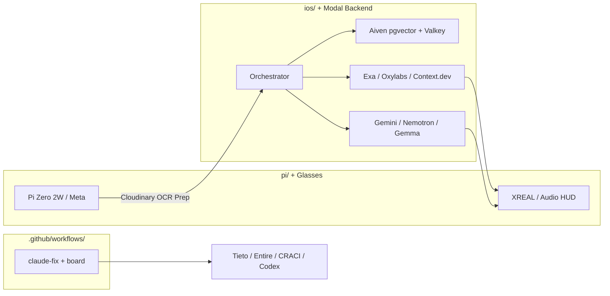

# Hack Junction 2026: Complete Challenge Cross-Check, Judging Rubrics & Maximum-ROI Strategy

**Event:** Junction 2026 — *European Tech Renaissance* (`eventId: 45`)  
**Team:** `@moterodiaz` (Mateo, Lead), `@Ahm3d-KA`, `@maksymmatviievskyi`, `@Marcus228`  
**Core Project:** **Wearable AR Context Engine** (`pi/`, `ios/`, `hud/`, `contracts/`) + **Autonomous Multi-Agent Board & Bounded PR Review Pipeline** (`tools/board`, `.github/workflows/claude-fix.yml`)

---

## 1. Executive Summary & The "Golden Stack" (Highest ROI Tracks)

Junction explicitly allows **submitting a single project to multiple challenges** (Main + Tech/Side tracks). Because your repository contains **two high-value engineering assets**—(A) the **Wearable AR Context Engine** (first-person camera + mic + AR HUD cognitive assistant) and (B) the **Hackathon Agent Board & Bounded AI PR Review Pipeline** (`tools/board` + `.github/workflows/claude-fix.yml`)—you can stack tracks that fit your architecture with near-zero throwaway work.

### Architecture-to-Sponsor Mapping



### The Recommended "Golden Stack" by Priority Tier

| Tier | Challenge Name & Type | Prize Pool | Effort to Integrate | Strategic Fit & Action Required |
| :--- | :--- | :--- | :--- | :--- |
| **TIER 1 (Main Cash)** | **Exa — "The Internet Butler / Your Personal Assistant"** *(Main, Agentic AI)* | **1st: $2,500 Cash** + $5k credits + hoodie + TRMNL<br>**2nd: $1,500 Cash** + $3k credits + macropad<br>**3rd: $500 Cash** | **~2 hrs** (`ios/` / backend route) | **9.5/10.** Frame the AR Context Engine as a first-person "Internet Butler" that sees what you are looking at (contracts, rent notices, datasheets, textbooks, menus) and calls **Exa Search & Contents API** (`EXA50JUNCTION`) to retrieve live, cited web answers directly onto the HUD. Judges test live queries! |
| **TIER 1 (Main Cash — Repo Asset)** | **Tieto — "Earned Trust in AI Code"** *(Main, Agentic AI)* | **1st: €2,000 Cash**<br>**2nd: €1,000 Cash**<br>**3rd: €500 Cash** | **~1.5 hrs** (Docs + 1 walkthrough PR) | **9.5/10.** You *already built* a bounded AI PR review & fix factory in `.github/workflows/claude-fix.yml` (Greptile review -> 5-commit loop cap -> `needs human: fix loop cap hit` escalation on Issue #1 -> human accountability gate blocking `gh pr merge`). Package it with a **Concept Card**, a **Live Walkthrough** on 1 agent PR with a requirement ID, and a **Lessons Log**. |
| **TIER 1 (Tech Cash)** | **Google DeepMind — Best Use of Gemini API** *(Tech)* | **1st: €4,000 Cash** + $1k GCP credits/member<br>**2nd: €2,000 Cash**<br>**3rd: €1,000 Cash** | **~1 hr** (Model router in `ios/`) | **10/10.** Add **Gemini 2.5 Flash / Pro** (or Gemini Multimodal Live API) alongside Claude in your `ios/` orchestrator for real-time multimodal vision + audio reasoning and long-context lecture memory. |
| **TIER 1 (Tech Cash)** | **Modal — Best Use of Modal** *(Tech)* | **1st: $2,000 Cash** + $3,000 Modal credits | **~2 hrs** (`modal deploy`) | **9.5/10.** Deploy your multimodal orchestrator, `faster-whisper` STT, SymPy math-verification sandbox, and open-weight VLM router as an autoscaling FastAPI WebSocket endpoint on **Modal** ($100 free GPU credits). |
| **TIER 1 (Tech Hardware)** | **NVIDIA — Best Use of Nemotron** *(Tech)* | **2x Winners: 1x NVIDIA RTX 5080 GPU** (~€1,400 value each) | **~1 hr** (OpenAI SDK call + text note) | **9.5/10.** Call **NVIDIA Nemotron 3.5 Super VL** (120B MoE, 12B active) via `https://integrate.api.nvidia.com/v1` or OpenRouter for vision-language frame analysis + tool calling. *Requires a short text note in the submission form.* |
| **TIER 1 (Tech Cash)** | **Google DeepMind — Best Use of Gemma** *(Tech)* | **Top 3 Teams: €1,000 Cash each** | **~1 hr** (Run on Modal / API) | **9/10.** Use **Gemma 3** (vision-capable open weights on Modal) as the fast, low-cost "Passive Book Mode" classifier/annotator. |
| **TIER 2 (Tech Cash/Vouchers)** | **Aiven — Best Use of Aiven** *(Tech)* | **1st: €1,000 Cash**<br>**2nd: €750 Cash**<br>**3rd: €500 Cash** | **~1.5 hrs** (Postgres + Valkey) | **8.5/10.** Store captured study cards, pHash frame embeddings (`pgvector`), and lecture session history in **Aiven for PostgreSQL** + **Aiven for Valkey** ($50 free credits). |
| **TIER 2 (Tech Vouchers/Cash)** | **Oxylabs — Best Agentic Usecase of Oxylabs Web API** *(Tech)*<br>**+ Context.dev — Structured Web** *(Tech)* | **Oxylabs:** €1,000 Apple Gift Voucher + $500 credits/member<br>**Context.dev:** €750 / €250 Cash | **~1 hr** (Live search/scrape fallback) | **8.5/10.** In "Lab Bench Mode" (IC datasheet lookup) & "Fact-Check Mode", call **Oxylabs Web API** (`/search` + `/scrape`) and **Context.dev API** at runtime and display source URLs on the HUD. *Both require a 2-sentence note in the submission stating which endpoints were used.* |
| **TIER 2 (Tech Gift Cards)** | **Cloudinary — Best Use of Cloudinary** *(Tech)* | **1st: $500 Amazon Gift Card per teammate** ($2,000 team total) | **~45 mins** + Survey Form | **8.5/10.** Pass low-light 1080p Pi Camera JPEG captures through Cloudinary's transformation API (auto-contrast, deskew, OCR crop) before sending to the VLM. *Must fill out `https://cld.media/hackathon-survey`.* |
| **TIER 2 (Main Hardware Option)** | **Meta — "AI Glasses for Everyone, Everyday"** *(Main, Hardware)* | **1st Only:** Ray-Ban Meta glasses per teammate (~€1,500 total hardware value) | **~3 hrs** (If borrowing Meta glasses at booth) | **10/10 Concept Fit.** Only pursue if you borrow a **Meta Ray-Ban Display** or **Gen 2** unit at the Meta booth (mentors: Amanda Le, Dennis Punjabi) and connect your `ios/` / web app via Meta Device Access Toolkit (DAT) or Web App alongside XREAL. |
| **TIER 2 (Main Cash Option)** | **Stoa — "Make Blueprints Talk"** *(Main, AI Infra)* | **1st: €1,000 Cash** + Work Trial<br>**2nd: €750 Cash**<br>**3rd: €250 Cash** | **~2 hrs** (Blueprint HUD mode) | **8/10.** Matches PRD Mode 4 (Engineering Diagrams). Point the glasses/camera at a construction blueprint or circuit schematic, answer natural language questions, and highlight bounding boxes on the HUD so a human can verify in seconds. |
| **TIER 3 (15-Min Freebies)** | **CRACI** + **ElevenLabs** + **Entire** + **OpenAI Codex** *(Tech)* | LEGO sets / Earbuds / Mini Projector / $10k OpenAI API Credits | **15 mins each** | **CRACI:** Change `runs-on: craci` in `.github/workflows/ci.yml`.<br>**ElevenLabs:** Stream TTS audio whisper to headphones alongside HUD text.<br>**Entire:** Run `entire` CLI on your multi-agent git repo.<br>**Codex:** Document your supervisor -> Codex sub-agent workflow from `AGENTS.md`. |

---

## 2. Official Deadlines, Rules, Judging Criteria & Submission Checklist

Extracted directly from the official Junction 2026 Participant Guide (`https://hackjunction.app/participate/45/guide`).

### Hard Schedule & Deadlines
1. **Friday 13.11 @ 23:59 — Pre-Submission Deadline:**
   - Create your draft project submission on the Junction Platform and select initial challenges.
   - You **can edit your submission and switch/add challenges** up until the final deadline on Sunday at 10:00.
   - **Rule Confirmation:** *"You are also allowed to submit a project to multiple challenges."*
2. **Saturday 14.11 @ 12:00 — Final Submission Form Opens:**
   - All final submission fields become editable on the Junction Platform.
3. **Sunday 15.11 @ 10:00 AM SHARP — FINAL SUBMISSION DEADLINE:**
   - The submission form closes automatically at **10:00:00**. Late submissions are strictly rejected.
   - **CRITICAL:** You must switch your submission toggle from **`DRAFT`** to **`FINAL`** and save before 10:00 AM.
4. **Sunday 15.11 @ 10:30–14:00 — Mandatory Live Peer & Partner Reviewing:**
   - Takes place physically at your assigned numbered table (published Saturday evening).
   - **Disqualification Warning:** Every team must review their assigned peer projects during the peer-review window AND remain at their table when partners/peers visit. If a reviewer presses **"Not Present"** for your table or your team fails to submit its assigned peer reviews, **your team is automatically disqualified from the €10,000 Main Prize**.
5. **Sunday 15.11 @ 14:15–15:10 — Top 5 Finalists Stage Pitching (for €10,000 Main Prize):**
   - Chosen via peer review scores across all tracks.
   - Format: **3 minutes pitch** (microphones are cut at 3:00 sharp) + **3 minutes Q&A** with a panel of 7 judges. Live demos from your own laptop are allowed and encouraged.

### Mandatory Submission Deliverables Checklist
Before Sunday 10:00 AM, verify every box below is complete:
- [ ] **Project Name, Punchline & Detailed Description** (including mandatory endpoint/model notes for **NVIDIA Nemotron**, **Oxylabs**, and **Context.dev** — template provided in Section 5 below).
- [ ] **Challenges Selected** on the Junction Platform (Main Challenge(s) + all integrated Tech Challenges).
- [ ] **Technologies Used** tags populated.
- [ ] **Video Pitch (STRICTLY ≤ 2:00 minutes):**
  - Official guide warning: *"The demo video should not be a second longer than 2 minutes, and we will be very strict with this."* Make it **1:50–1:58** to avoid YouTube player rounding to `2:01`.
  - Hosted publicly (YouTube Unlisted/Public or Vimeo — test in an Incognito window!).
- [ ] **Public GitHub Repository Link with MIT License:**
  - Official rule: All submissions must use the **MIT Open Source License** (`LICENSE` already exists in `Junction-Prep/LICENSE` — ensure it is at the root of the submitted GitHub repo `moterodiaz/Junction`).
- [ ] **Live Demo URL** (e.g., your `modal deploy` public web HUD / dashboard URL).
- [ ] **Pitch Deck (`PDF` file uploaded to the platform).**
- [ ] **Team Contact Info:** Phone numbers and Discord usernames for `@moterodiaz`, `@Ahm3d-KA`, `@maksymmatviievskyi`, and `@Marcus228`.
- [ ] **External Sponsor Forms (if entering these tracks):**
  - [ ] **Cloudinary:** Fill out `https://cld.media/hackathon-survey`
  - [ ] **Verda Compute Track (if used):** Post a short summary + submission link in Verda's channel on the Junction Discord.
  - [ ] **Arduino (if used):** Publish project on `https://projecthub.arduino.cc/` with tag `Junction Finland 2026`.

### General Junction Evaluation Criteria (Used in Peer Review & €10,000 Main Prize)
1. **Innovation (33%):** Is the concept or prototype new, original, or meaningfully differentiated from existing products?
2. **Impact (33%):** Could the solution have a significant impact on society and help a high ratio of people?
3. **Implementation (33%):** Is the prototype realistic, viable, and technically feasible in a live demonstration?

---

## 3. Deep-Dive on Recommended Main Challenges

### Main Option A: Exa — "The Internet Butler / Your Personal Assistant" (`ID: 298`, Agentic AI Track)
- **Prizes:**
  - **1st Place:** **$2,500 Cash** + $5,000 in Exa credits + Exa hoodie per person + Exa-branded TRMNL e-ink dashboard
  - **2nd Place:** **$1,500 Cash** + $3,000 in Exa credits + Exa hoodie per person + Exa-branded macropad
  - **3rd Place:** **$500 Cash** + $1,000 in Exa credits + Exa hoodie per person
  - **Free Credits Promo Code:** `EXA50JUNCTION` ($50 free credits per participant at `https://dashboard.exa.ai/billing`)
- **Official Judging Rubric (100%):**
  1. **Use of Exa (20%):** Use of Exa to retrieve information that *could not have come from a model's training data alone* (live regulations, current prices/availability, recent papers, local laws, specific datasheets).
  2. **Usefulness (20%):** Usefulness to a specific group of real people taking tedious research tasks off their hands.
  3. **Clarity in Showing Sources (20%):** Explicit citation cards/links proving where every fact came from.
  4. **Originality (20%):** How original the personal assistant concept and form factor are (a wearable first-person AR/audio butler stands out massively from 40 generic chat web apps!).
  5. **Working Implementation on Live Queries (20%):** *"Whether the demo works on live queries, including ones the judges try themselves."*
- **How to Tailor the AR Context Engine for Exa:**
  - When the user looks at a physical document (e.g., a Finnish/EU apartment lease rent-increase notice, a medical/student benefit form, a hardware circuit component, or a textbook problem) or speaks a request, the iOS/Modal orchestrator extracts the entities via VLM and runs an **Exa Search + Contents API** query (`type="auto"`, `contents={"text": True, "highlights": True, "summary": True}`).
  - The HUD (`hud/`) renders a dedicated **"Exa Verified Sources"** peripheral card showing the live web verdict, action steps, and exact source domain/title/date, while preparing the final action (e.g., draft reply, benefit checklist, or pinout overlay) for one-tap human approval on the iPhone screen.

---

### Main Option B: Tieto — "Earned Trust in AI Code" (`ID: 351`, Agentic AI Track)
- **Prizes:**
  - **1st Place:** **€2,000 Cash**
  - **2nd Place:** **€1,000 Cash**
  - **3rd Place:** **€500 Cash**
- **Why You Have an Unfair Advantage Here:**
  - In `.github/workflows/claude-fix.yml`, `AGENTS.md`, and `tools/board`, you have *already built* a working multi-agent PR review factory with Greptile automated code review, an autonomous fixer (`claude-fix`) capped at 5 commits, explicit human escalation (`needs human: fix loop cap hit` or merge conflicts posted to the pinned GitHub Issue #1 board tagging the named human author), and a hard rule preventing agents from running `gh pr merge` without human accountability.
- **Official Judging Rubric (100%):**
  1. **Clarity (30%):** A clear recommendation with stated principles, explicit trade-offs, and limits.
  2. **Practicality (25%):** The concept works in a real pull-request flow and scales, with a named human owning each decision.
  3. **Measurement (25%):** Shows how trust is measured: reverts and incidents don't rise as review time falls, AI findings are real and accepted, time to merge, share routed to humans.
  4. **Evidence (20%):** Evidence traceable to a requirement ID lets a named human accept a change without a full line-by-line read, including **what the AI found, what it refused to decide, and why**.
- **Mandatory Deliverables Required by Tieto:**
  1. **Concept Card (`docs/TIETO_CONCEPT_CARD.md`):** Recommendation, core principles (balancing risk, hallucination, transparency, confidence, and quality), what the named owner signs off on (*what was checked, what was NOT checked & why, residual risk accepted*), trade-offs, and limits.
  2. **Live Walkthrough on 1 Sample Agent-Written PR with Requirement ID:**
     - Add a self-explaining PR header generated by your workflow on a real PR in `moterodiaz/Junction` (tied to a Requirement ID, e.g., `REQ-WS-01: WebSocket Frame Schema & Rate Limiting` across frontend `hud/`, backend `pi/`+`ios/`, and security).
     - Explicitly display three blocks in the PR comment:
       - **Verified by AI (with traceable evidence/tests)**
       - **Refused by AI / Escalated to Named Human (`@moterodiaz`) & Why** (e.g., security boundary change, contract breaking change, or loop cap hit)
       - **Named Human Accountability Sign-Off Block** + Metrics panel (Review Time Saved, AI Finding Acceptance Rate, Escape/Revert Rate, % Routed to Human).
  3. **Lessons Log (`docs/TIETO_LESSONS_LOG.md`):** Document the real failure modes you already encountered today (e.g., Devin reporting "pass" while reviewing nothing due to credits, infinite bot-fix loops requiring the 5-commit cap, rebase vs. merge conflicts on bot-pushed branches).

---

### Main Option C: Meta — "AI Glasses for Everyone, Everyday" (`ID: 342`, Hardware Track)
- **Prize:**
  - **Best Overall (1st Place Only):** 1x pair of Ray-Ban Meta glasses for each team member (no cash).
- **Hardware Availability at Junction:**
  - Meta lends **10x Meta Ray-Ban Display** and **10x Ray-Ban Meta Gen 2** at the Meta booth.
  - On-site mentors: **Amanda Le** & **Dennis Punjabi** (Mobile Apps with Device Access Toolkit - iOS), **Niharika** & **David** (Web Apps).
- **Official Judging Rubric (100%):**
  1. **Creativity & Use Case (25%):** Original, relevant everyday scenario with a clear first-person wearable benefit beyond mirroring a phone screen.
  2. **Technical Execution (25%):** Functional prototype that handles **permissions, errors, performance trade-offs, connectivity drops, and device state changes** gracefully.
  3. **Real-World Value & Feasibility (25%):** Clear target user and plausible path to adoption or pilot.
  4. **User Experience: Input, Accessibility & Trust (25%):** Intuitive, inclusive interaction design for **people with all abilities** (both display and audio-first experiences are judged on equal footing), with appropriate **bystander/user consent and safe data practices**.
- **What You Must Add to `ios/` & `hud/` to Win Meta:**
  - Even if you demo on both borrowed Meta Ray-Ban glasses (via iOS Device Access Toolkit / Bluetooth audio + camera stream) and XREAL + Pi Zero 2 W, add an explicit **Accessibility Mode** (audio-first whisper descriptions + high-contrast dyslexia/low-vision HUD cards), a **Privacy & Consent Indicator** (auto-redacting faces/PII before cloud upload + clear recording state pill), and a **Connectivity / Device State HUD Banner** showing graceful offline caching when Wi-Fi/BLE drops.

---

### Main Option D: Stoa — "Make Blueprints Talk" (`ID: 335`, AI Infrastructure Track)
- **Prizes:**
  - **1st Place:** **€1,000 Cash** + Direct invitation to a work trial at Stoa
  - **2nd Place:** **€750 Cash**
  - **3rd Place:** **€250 Cash**
- **Official Judging Rubric (100%):**
  1. **Accuracy of Answers (25%):** Grounded answers extracted from complex construction drawings, floor plans, or technical schematics.
  2. **Visualized Reasoning (25%):** Highlight the exact region/bounding box in the drawing where the answer came from so a human engineer can verify it in seconds.
  3. **Creativity (25%):** Novel interface or workflow (first-person AR glasses + interactive blueprint inspector).
  4. **Low Inference Cost (25%):** Smart tiling/cropping + lightweight model routing (e.g., coarse crop detection with Gemma/Flash before high-res crop reasoning, logging exact token cost per query on screen!).

---

## 4. Deep-Dive on Recommended Tech / Side Challenges (Stackable!)

Tech Challenges are judged by each partner separately from your Main Challenge. Below are the exact requirements, promo codes, and implementation hooks for the highest-ROI Tech Challenges.

### 1. Google DeepMind — "Best Use of Gemini API" (`ID: 48`)
- **Prizes:** **1st: €4,000 Cash** + $1,000 GCP credits/member | **2nd: €2,000 Cash** | **3rd: €1,000 Cash** (Participants must be 18+).
- **Judging Criteria:** Impact, Innovation, Execution (making Gemini API core to the multimodal reasoning pipeline).
- **Exact Implementation Hook:**
  - In your `ios/` or Modal orchestrator, use `gemini-2.5-flash` (for sub-second real-time HUD streaming and frame triage) and `gemini-2.5-pro` (for multi-page textbook/lecture synthesis and blueprint/circuit reasoning).
  - Emphasize Gemini's native multimodal input (simultaneous 1080p image + 16kHz PCM audio chunk + rolling lecture transcript in a 1M-token context window).

### 2. Modal — "Best use of Modal" (`ID: 40`)
- **Prizes:** **1st Team: $2,000 Cash + $3,000 Modal credits** ($100 free credits per participant).
- **Judging Criteria:** Impact, Innovation, Execution — taking your hackathon project from laptop to autoscaling production AI on Modal.
- **Exact Implementation Hook:**
  - Create `backend/modal_app.py` decorated with `@app.function(gpu="L4")` or `@modal.asgi_app()`.
  - Use Modal for three concrete features that Modal judges love:
    1. **Autoscaling WebSocket / SSE Orchestrator** (`modal deploy`) connecting `pi/`, `ios/`, and `hud/`.
    2. **Isolated `modal.Sandbox`** to execute LLM-generated SymPy / Python code safely when verifying handwritten math derivations or physics equations in Mode 3!
    3. **Open-Weight GPU Inference** serving `faster-whisper` and **Gemma 3** on a serverless GPU that scales to zero when idle.

### 3. NVIDIA — "Best Use of Nemotron" (`ID: 46`)
- **Prizes:** **Two winning teams each receive 1x NVIDIA RTX 5080 GPU.**
- **Model Required:** **NVIDIA Nemotron 3.5 Super VL** (120B parameters total, 12B active per token MoE; handles text, images, documents, and video + tool-calling in one workflow).
- **API Access:** OpenAI-compatible API via `https://integrate.api.nvidia.com/v1` (NVIDIA NIM) or OpenRouter.
- **MANDATORY SUBMISSION TEXT REQUIREMENT:**
  - You must include a short paragraph in your Junction submission description covering:
    1. Which Nemotron model you used (`Nemotron 3.5 Super VL`),
    2. What it does in your workflow (analyzing captured 1080p document/whiteboard/schematic frames and calling verification/search tools),
    3. Why it matters (12B active MoE latency enables interactive AR HUD updates while retaining 120B multimodal document reasoning),
    4. How you improved outputs (edge motion-gating + Cloudinary contrast normalization + structured JSON schema enforcement).

### 4. Google DeepMind — "Best Use of Gemma" (`ID: 47`)
- **Prizes:** **Top 3 teams win €1,000 Cash each** (unranked).
- **Exact Implementation Hook:**
  - Run **Gemma 3** (4B or 12B Vision-Instruct) on your Modal GPU endpoint (or via Featherless / Google API) as the ultra-fast **Tier-1 Edge/Cloud Filter & Passive Book Annotator** that classifies whether a newly captured still frame is a `textbook_page`, `whiteboard_derivation`, `blueprint_schematic`, or `hardware_pcb`, and generates instant vocabulary/summary pills.

### 5. Aiven — "Best Use of Aiven" (`ID: 43`)
- **Prizes:** **1st: €1,000 Cash** | **2nd: €750 Cash** | **3rd: €500 Cash** ($50 free credits at `https://console.aiven.io/signup`).
- **Exact Implementation Hook:**
  - Provision **Aiven for PostgreSQL** (with `pgvector` enabled) and **Aiven for Valkey** (Redis-compatible in-memory cache).
  - Use **Aiven Valkey** to store the 64-bit perceptual hashes (`pHash`) of recently seen pages and active WebSocket session state so re-looking at the same whiteboard/page returns cached HUD cards in `<15 ms`.
  - Use **Aiven PostgreSQL (`pgvector`)** to store every captured study card, OCR snippet, verified equation, and cited web source so the user can semantically search their past lectures ("What did the professor write on the board 20 minutes ago about Fourier transforms?").

### 6. Oxylabs — "Best agentic usecase of Oxylabs Web API" (`ID: 32`)
- **Prize:** **1st: €1,000 Apple Gift Voucher + $500 Oxylabs credits per team member.**
- **Minimum Requirements:**
  1. Must call the **Oxylabs Web API at runtime** (`/search` to find, `/scrape` to read live pages).
  2. Must visibly ground answers in current, cited source URLs displayed to the user.
  3. **Mandatory Submission Note:** Add a short note in the submission stating which Oxylabs Web API endpoints you used and why.

### 7. Context.dev — "Best Use of Context.dev: Fully Structured Web" (`ID: 44`)
- **Prizes:** **1st: €750 Cash + swag** | **2nd: €250 Cash + swag** | **3rd: Swag**.
- **Minimum Requirements:**
  1. Call **at least one Context.dev API endpoint in the core flow**, visibly driving part of the demo.
  2. **Mandatory Submission Note:** Include a short note in the submission on which Context.dev endpoints you used and why.

### 8. Cloudinary — "Best Use of Cloudinary" (`ID: 41`)
- **Prize:** **1st: $500 Amazon Gift Card per team member** ($2,000 total for a team of 4).
- **Minimum Requirements:**
  1. Use one of the four Cloudinary tools listed at `https://cld.media/hackathons` to meaningfully transform, optimize, or analyze visual media (not just static CDN hosting).
  2. **MANDATORY EXTERNAL FORM:** Submit your project at **`https://cld.media/hackathon-survey`** before Sunday 10:00 AM!
- **Exact Implementation Hook:**
  - Head-mounted cameras in lecture halls and labs suffer from perspective skew, motion blur, and low contrast. Before passing the Pi Zero 2 W's 1080p JPEG to the VLM, upload/transform it via Cloudinary with `e_improve,e_sharpen,q_auto,f_auto` (and generative restore/crop on regions of interest) and display the "Raw Camera vs. Cloudinary Enhanced OCR Crop" side-by-side on the companion debug view.

### 9. Zero-Friction Bonus Side Tracks (< 15 Minutes Effort Each)
- **CRACI — "Best use of CRACI" (`ID: 42`):**
  - **Prizes:** **1st:** LEGO set per teammate | **2nd:** 24-pack Red Bull per teammate | **3rd:** Slush CRACI x OpenAI lunch invite | **Top 5:** 50,000 CRACI CI/CD build mins + job interview.
  - **Requirement:** Run your GitHub Actions CI on CRACI (`runs-on: craci` in `.github/workflows/`). You already have `.github/workflows/claude-fix.yml`!
- **MLH — "Best Use of ElevenLabs" (`ID: 50`):**
  - **Prize:** Wireless Earbuds per teammate.
  - **Requirement:** Add ElevenLabs TTS streaming (`eleven_flash_v2_5`) so the wearer hears a concise natural voice whisper of the answer while seeing the visual formula/citation card on the HUD.
- **MLH — "Best Use of Entire" (`ID: 51`):**
  - **Prize:** Mini Portable Projector.
  - **Requirement:** Use the open-source `entire` CLI on your `moterodiaz/Junction` repo to capture AI coding agent sessions, checkpoints, and trails alongside `tools/board`.
- **OpenAI — "Best Use of Codex" (`ID: 49`):**
  - **Prizes:** **1st:** $10,000 OpenAI API credits | **2nd:** $5,000 credits | **3rd:** $2,500 credits ($100 free credits in Hackerpack).
  - **Requirement:** Showcase how your team used OpenAI Codex (`AGENTS.md` supervisor + worktree sub-agents) to build and verify the codebase in parallel.

---

## 5. Component-by-Component Implementation Map & Drop-In Snippets

Here is how each teammate's folder (`contracts/`, `pi/`, `ios/` + `modal/`, `hud/`, `.github/workflows/`) wires these tracks together cleanly without stepping on each other's files.

### A. `contracts/` (`@moterodiaz`) — Unified WebSocket Schema
Include fields for model attribution, bounding-box highlights (Stoa/HUD), verified math execution (Modal Sandbox), and live citations (Exa/Oxylabs/Context.dev) so every sponsor integration is visible in the HUD payload:

```json
{
  "type": "hud_card_stream",
  "frame_id": "sha256-or-phash",
  "mode": "butler_research | lecture | math_verify | blueprint_lab",
  "cloudinary_enhanced_url": "https://res.cloudinary.com/.../e_improve,e_sharpen/frame.jpg",
  "model_used": "gemini-2.5-flash | nvidia/nemotron-3.5-super-vl | gemma-3-12b-it",
  "inference_cost_usd": 0.00042,
  "latency_ms": 680,
  "title": "IC Pinout & Datasheet Verification (NE555)",
  "body_markdown": "Pin 1 is **GND**, Pin 8 is **VCC (4.5V–16V)**...",
  "latex_block": "\\mathcal{F}\\{f(t)\\} = \\int_{-\\infty}^{\\infty} f(t)e^{-i\\omega t}dt",
  "sympy_verified": true,
  "highlight_bbox": { "x": 0.32, "y": 0.41, "w": 0.18, "h": 0.12, "label": "Pin 1 Notch" },
  "citations": [
    {
      "provider": "exa | oxylabs | context.dev",
      "title": "TI NE555 Precision Timer Datasheet (Rev. L)",
      "url": "https://www.ti.com/lit/ds/symlink/ne555.pdf",
      "snippet": "Supply voltage range: 4.5 V to 16 V..."
    }
  ],
  "audio_tts_url": "/api/tts/elevenlabs/stream/frame_id",
  "device_state": { "battery_pct": 88, "link_quality": "good", "privacy_pii_redacted": true }
}
```

### B. `ios/` & `backend/` (Modal Serverless Orchestrator)
Drop-in multi-sponsor router structure (`backend/modal_app.py`) hitting **Modal**, **Gemini API**, **NVIDIA Nemotron**, **Gemma**, **Exa**, **Oxylabs**, **Context.dev**, **Cloudinary**, **Aiven**, and **ElevenLabs**:

```python
import os
import modal

app = modal.App("junction-ar-context-engine")
image = modal.Image.debian_slim(python_version="3.11").pip_install(
    "fastapi[standard]", "google-genai", "openai", "exa-py",
    "cloudinary", "psycopg[binary]", "redis", "elevenlabs", "sympy", "httpx"
)

@app.function(image=image, timeout=30)
def verify_math_in_sandbox(sympy_expr_lhs: str, sympy_expr_rhs: str) -> dict:
    """Runs symbolic equivalence verification inside a Modal function/sandbox."""
    import sympy as sp
    diff = sp.simplify(sp.sympify(sympy_expr_lhs) - sp.sympify(sympy_expr_rhs))
    return {"verified": diff == 0, "residual": str(diff)}
```

### C. `.github/workflows/` — 1-Line CRACI + Tieto Accountability Gate
1. **To qualify for CRACI (`ID: 42`):** Add a lightweight CI workflow (or update `.github/workflows/ci.yml`) that runs unit/contract validation on `runs-on: craci`.
2. **To win Tieto (`ID: 351`):** Add `docs/TIETO_CONCEPT_CARD.md` and `docs/TIETO_LESSONS_LOG.md`, and have `.github/workflows/claude-fix.yml` post a structured **Accountability & Evidence Summary** comment on each PR showing:
   - Requirement ID & Scope
   - What Greptile + Claude verified automatically
   - What the agent refused to auto-decide (and why)
   - Named Human Sign-Off checklist (`@moterodiaz`).

### D. Ready-to-Paste Submission Notes (Required by NVIDIA, Oxylabs & Context.dev)
Paste the following block at the bottom of your Junction Platform project description so judges never disqualify you on a missing note:

```markdown
### Partner API & Model Usage Notes
- **NVIDIA Nemotron:** We use **NVIDIA Nemotron 3.5 Super VL** (120B MoE / 12B active) via the OpenAI-compatible endpoint to perform joint multimodal visual reasoning and tool-calling on 1080p frames captured by the wearable camera (textbooks, whiteboards, blueprints, and hardware PCBs). Its 12B active parameter path gives us interactive AR HUD latency while retaining 120B document comprehension. We improved outputs by pre-filtering motion blur on the edge (SSIM gate on Pi Zero 2 W), normalizing contrast via Cloudinary transformations, and enforcing strict JSON schema outputs with SymPy verification.
- **Oxylabs Web API:** We call the Oxylabs Web API at runtime (`/search` for live query discovery and `/scrape` for extracting full technical datasheets, regulatory pages, and fact-check sources) whenever the wearer looks at an unfamiliar component, contract clause, or claim. Extracted source URLs and snippets are rendered directly in the AR HUD's citation card.
- **Context.dev API:** We call Context.dev's structured web extraction endpoint in our core assistant loop to enrich entities (organizations, products, news, and technical references) spotted in the wearer's field of view into clean structured JSON cards on the HUD.
- **Google DeepMind Gemini API & Gemma:** We use **Gemini 2.5 Flash & Pro** for native multimodal audio+vision streaming and 1M-token full-lecture context recall, paired with **Gemma 3** hosted on **Modal** for fast Tier-1 frame classification and passive study annotations.
- **Aiven & Cloudinary:** Frames are enhanced and deskewed via **Cloudinary** prior to OCR/VLM inference; perceptual hashes (`pHash`) and session state are cached in **Aiven for Valkey**, and all study cards + vector embeddings are persisted in **Aiven for PostgreSQL (`pgvector`)**.
```

---

## 6. Complete Reference Catalog of All 38 Junction 2026 Challenges

For completeness, every single Main and Tech challenge on the Junction 2026 platform (`hackjunction.app/participate/45/challenges`) has been cross-checked below.

### All 19 Main Challenges

| ID | Sponsor & Title | Track | Prizes | Fit Score | Verdict |
| :--- | :--- | :--- | :--- | :--- | :--- |
| **298** | **Exa** — *The Internet Butler / Your Personal Assistant* | Agentic AI | **1st:** $2,500 + $5k cred + hoodie + TRMNL<br>**2nd:** $1,500 + $3k cred + macropad<br>**3rd:** $500 + $1k cred | **9.5/10** | **PRIMARY TARGET (AR Engine).** High cash, 100% compatible with first-person AR assistant + live web citations. |
| **351** | **Tieto** — *Earned Trust in AI Code* | Agentic AI | **1st:** €2,000<br>**2nd:** €1,000<br>**3rd:** €500 | **9.5/10** | **PRIMARY TARGET (Repo PR Pipeline).** Directly matches `.github/workflows/claude-fix.yml` + `tools/board`. |
| **342** | **Meta** — *AI Glasses for Everyone, Everyday* | Hardware | **1st:** Ray-Ban Meta glasses per teammate | **10/10** | **TARGET IF BORROWING META GLASSES.** Hardware-only prize, requires Meta glasses / DAT / Web App. |
| **335** | **Stoa** — *Make Blueprints Talk* | AI Infra | **1st:** €1,000 + Work Trial<br>**2nd:** €750<br>**3rd:** €250 | **8.0/10** | **STRONG OPTIONAL ADD-ON.** Add Blueprint/Schematic bounding-box highlight mode to the AR HUD. |
| **356** | **Arduino** — *The Green European Renaissance* | Hardware | **1st:** Ventuno Q/member<br>**2nd:** UNO Q 4G + Kit<br>**3rd:** Plug & Make Kit | **4.0/10** | **SKIP MAIN TRACK** unless swapping Pi Zero 2 W for borrowed Arduino UNO Q + green/accessibility angle + Project Hub post. |
| **343** | **Aalto University** — *Beyond the Clinic* | Healthcare | To be announced | **3.5/10** | **SKIP.** Uncertain prize pool ("TBA") and requires depression TMS home-maintenance framing. |
| **350** | **Cala** — *Make Unicorns Real* | Agentic AI | **1st:** €5,000 Hackathon Travel Package + €1k cred<br>**2nd:** €500 cred | **3.0/10** | **SKIP.** Requires founder/investor startup intelligence product built around Cala (`MAKEUNICORNSREAL`). |
| **334** | **Context.dev** — *Build a Live Database of Anything* | Data | **1st:** €2,000<br>**2nd:** €500 | **3.0/10** | **SKIP MAIN TRACK** (enter Context.dev's €750 Tech Challenge instead, which fits your AR assistant directly). |
| **338** | **MariaDB** — *Unlock Wikipedia's Untapped Potential* | Data | **1st:** €1,000 + €1k UpCloud<br>**2nd:** €500<br>**3rd:** €250 | **3.0/10** | **SKIP.** Specifically requires Finnish Wikipedia history datasets + MariaDB Vector or System-Versioned Tables. |
| **357** | **Hostinger** — *Decode the Noise* | Agentic AI | **1st:** €2,000<br>**2nd:** €1,000<br>**3rd:** €500 | **2.0/10** | **SKIP.** Requires propaganda/bot-network/traffic-log detector deployed on Hostinger VPS. |
| **346** | **Valio Aimo** — *Trusted Trade Agents* | Agentic AI | **1st:** €4,000<br>**2nd:** €2,000<br>**3rd:** €1,000 | **1.5/10** | **SKIP.** Requires B2B foodservice wholesale purchasing agent interface. |
| **348** | **AfterQuery** — *Break the Agent* | Agentic AI | **1st:** €3,000 + Work Trial<br>**2nd:** €1,500<br>**3rd:** €500 | **1.5/10** | **SKIP.** Requires building a custom RL environment + reproducible evaluation harness that breaks frontier agents. |
| **349** | **Bahn Express** — *Spread* | Agentic AI | **1st:** €2,000<br>**2nd:** €1,000<br>**3rd:** €500 | **1.0/10** | **SKIP.** Dedicated car-transport dispatch simulation game (`spread-kmu9z6`) with Sunday 08:00 tournament. |
| **341** | **Ignite Next x Intel** — *The Intel Physical AI Challenge* | Hardware | **1st:** €5,000<br>**2nd:** €3,000<br>**3rd:** €2,000 | **1.0/10** | **SKIP.** Requires on-site SO-101 robot arm teleoperation + Duplo brick defect sorting with Anomalib & OpenVINO. |
| **340** | **Rokoko** — *The Robot Teleoperation Challenge* | Hardware | Mocap gloves / suit hardware | **1.0/10** | **SKIP.** Requires Rokoko motion-capture suit/gloves controlling robotic arms/humanoids. |
| **339** | **Aalto University** — *Humanoid Touches the World* | Hardware | **1st:** €2,000 | **1.0/10** | **SKIP.** Requires Unitree G1 humanoid block sorting in NVIDIA Isaac Sim. |
| **344** | **AstraZeneca** — *Equal Care Across Finland* | Healthcare | **1st:** €1,000<br>**2nd:** €750<br>**3rd:** €250 | **1.0/10** | **SKIP.** Requires Finnish national cancer care pathway bottleneck analytics. |
| **337** | **S-Pankki** — *Talk to Your Bank* | Data | **1st:** €2,000 Airbnb<br>**2nd:** €1,000 Airbnb<br>**3rd:** €500 Airbnb | **1.0/10** | **SKIP.** Requires conversational analytics over S-Pankki's synthetic personal banking dataset. |
| **336** | **City of Espoo** — *Match Skills to Work that Matters* | Data | **1st:** €1,500<br>**2nd:** €1,000<br>**3rd:** €500 | **1.0/10** | **SKIP.** Requires public-sector HR/recruitment matching platform. |

---

### All 19 Tech / Side Challenges

| ID | Sponsor & Title | Prizes | Fit Score | Verdict & Special Requirements |
| :--- | :--- | :--- | :--- | :--- |
| **48** | **Google DeepMind** — *Best Use of Gemini API* | **1st:** €4,000 + $1k GCP/member<br>**2nd:** €2,000<br>**3rd:** €1,000 | **10/10** | **MUST DO.** Route multimodal vision + audio/context through Gemini 2.5 Flash/Pro. |
| **40** | **Modal** — *Best use of Modal* | **1st:** $2,000 Cash + $3,000 credits | **9.5/10** | **MUST DO.** Deploy FastAPI WS backend, Whisper STT, Gemma, and SymPy sandbox on Modal (`modal deploy`). |
| **46** | **NVIDIA** — *Best Use of Nemotron* | **2x Winners:** 1x NVIDIA RTX 5080 GPU | **9.5/10** | **MUST DO.** Call `Nemotron 3.5 Super VL` for document/board/circuit vision + include required text explanation in submission. |
| **47** | **Google DeepMind** — *Best Use of Gemma* | **Top 3 Teams:** €1,000 Cash each | **9.0/10** | **MUST DO.** Run Gemma 3 on Modal for fast Tier-1 frame classification & passive book annotations. |
| **43** | **Aiven** — *Best Use of Aiven* | **1st:** €1,000<br>**2nd:** €750<br>**3rd:** €500 | **8.5/10** | **DO THIS.** Use Aiven PostgreSQL (`pgvector`) for study card memory + Aiven Valkey for `pHash` frame caching. |
| **32** | **Oxylabs** — *Best agentic usecase of Oxylabs Web API* | **1st:** €1,000 Apple Voucher + $500 cred/member | **8.5/10** | **DO THIS.** Live `/search` + `/scrape` calls for datasheets/fact-checks + show source URLs + note endpoints in submission. |
| **44** | **Context.dev** — *Best Use of Context.dev* | **1st:** €750 + swag<br>**2nd:** €250 + swag | **8.5/10** | **DO THIS.** Call ≥1 Context.dev endpoint in core lookup flow + note endpoints in submission. |
| **41** | **Cloudinary** — *Best Use of Cloudinary* | **1st:** $500 Amazon Gift Card / member | **8.5/10** | **DO THIS.** Deskew/enhance Pi Camera frames via Cloudinary API + **must submit `https://cld.media/hackathon-survey`**. |
| **42** | **CRACI** — *Best use of CRACI* | **1st:** LEGO set/member<br>**2nd:** 24-pack Red Bull/member<br>**Top 5:** 50k build mins | **9.5/10** | **FREEBIE (2 mins).** Set `runs-on: craci` in `.github/workflows/`. |
| **50** | **MLH** — *Best Use of ElevenLabs* | Wireless Earbuds / member | **9.0/10** | **EASY ADD-ON.** Stream ElevenLabs TTS voice whisper alongside visual HUD cards. |
| **51** | **MLH** — *Best Use of Entire* | Mini Portable Projector | **9.0/10** | **EASY ADD-ON.** Run `entire` CLI on your multi-agent git repository. |
| **49** | **OpenAI** — *Best Use of Codex* | **1st:** $10k API cred<br>**2nd:** $5k cred<br>**3rd:** $2.5k cred | **9.0/10** | **EASY ADD-ON.** Document your `AGENTS.md` Codex sub-agent workflow. |
| **56** | **Verda** — *Verda Compute Track* | **1st:** $10k cloud cred + hoodies<br>**2nd/3rd:** $2.5k cred | **6.0/10** | **OPTIONAL.** Cloud credits only; requires posting summary + submission link in Verda's Discord channel. |
| **45** | **Arduino** — *Best use of Arduino Uno Q* | UNO Q + Plug & Make Kit / member | **5.0/10** | **OPTIONAL.** Only if you borrow an UNO Q from 5th floor Hardware Lab and publish to `projecthub.arduino.cc`. |
| **29** | **Atech** — *Atech Real World Challenge* | Pro Atech hardware kit | **4.0/10** | **SKIP** unless you snap an Atech ESP32 module onto your wearable rig (`atech.dev`, code `JUNCTION`). |
| **55** | **MLH** — *Best Use of MongoDB Atlas* | M5Stack IoT Kit | **3.0/10** | **SKIP** in favor of Aiven (€1,000 cash vs. IoT kit). |
| **54** | **MLH** — *Best Use of Vultr* | M5Stack mini programmable monitor | **3.0/10** | **SKIP** in favor of Modal ($2,000 cash vs. monitor). |
| **53** | **MLH** — *Best Use of Tiger Data* | Stream Deck Mini | **3.0/10** | **SKIP** unless you already use Timescale/Tiger Data. |
| **52** | **MLH** — *Best Use of Solana* | Unruggable Hardware Wallets | **1.0/10** | **SKIP.** Unrelated to cognitive AR assistant. |
