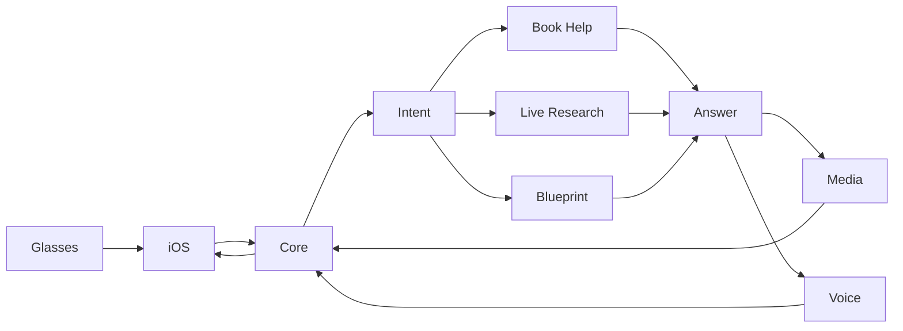

# MetaLab: product requirements

**Event:** Junction 2026. Final submission Sunday 15.11 at 10:00 sharp.
**Team:** @moterodiaz (lead), @Marcus228, @Ahm3d-KA, @maksymmatviievskyi
**Status:** agent-facing specification, not a claim that features or challenges are ready. Replaces the Wearable AR Context Engine PRD. Sections 1–11 retain their original meanings and anchors; §§12–14 specify the approved additions. Execute [IMPLEMENTATION_PLAN.md](IMPLEMENTATION_PLAN.md), use the existing [requirement registry](../docs/REQUIREMENTS.md), and preserve current issues and approved handoffs. This documentation pass implements no runtime features.

Facts about Meta, Gemini and NVIDIA in this document were checked against the vendors' own docs on 2026-11-14. Anything we could not confirm is listed in section 10 as an open question with an owner. Do not promote an open question to a fact without testing it on the hardware.

## 1. Pitch and target user

A high-school student is reading Shakespeare and hits a passage they cannot picture. They ask for help out loud. The glasses take one photo of the page, and a few seconds later an illustration of that passage appears on the lens with a two-line explanation, which is also read aloud.

The target user is a student working through an assigned text. Prove this reading scenario first. Natural follow-ups, live research and better spoken answers extend the same product. Construction drawings are a gated document mode with a distinct, versioned grounding contract and sponsor-cleared data, not merely a different prompt or a separate sponsor product.

## 2. Why this is not Meta AI

This is the team's positioning. Sharpen it with the Meta mentors before the pitch.

- **Memory within the current book session.** MetaLab keeps text-only context: play, act, characters and prior questions. The tenth question can use the first nine. Explicit session end deletes it; abandoned sessions expire. This is not persistent whole-book storage.
- **Sources for that book.** For the demo plays we load the public-domain text, so explanations can quote and place the passage (act, scene, line) instead of guessing from one photo.
- **A picture, not a paragraph.** The answer is an illustration built for the lens, with a short caption and a spoken version.

## 3. Base-case flow

1. The student says "Hey Meta, start <app name>" or taps the button in the phone app.
2. The phone app records a short spoken command from the glasses microphone and grabs one frame from the glasses camera.
3. Both go to the backend over one WebSocket message.
4. The backend transcribes the command, reads the page, reasons over the passage with the book session, and generates an illustration.
5. The lens shows progress while this runs ("Reading page", "Drawing"), then the card: image plus caption.
6. The answer is spoken through the glasses speakers. The flow must make sense with the display off.

Capture happens only on invocation. There is no continuous video stream, for cost and for privacy.

## 4. Architecture

```
Ray-Ban Display glasses
   camera frame, mic audio, lens display, speakers
        |  Bluetooth, Meta Wearables Device Access Toolkit (DAT)
        v
iOS app, Swift (ios/)            thin client, no model calls
   invoke -> one frame + one audio clip
        |  WebSocket (contracts/)
        v
FastAPI orchestrator on Modal (backend/app/)
   1. speech to text, preserve utterance; bounded intent dispatch (backend/stt/, backend/app/)
   2. Nemotron 3.5 Super VL reads the page  (backend/ai/)
   3. Gemini reasons: passage + book session -> explanation + image prompt
   4. Gemini generates the image
   5. image stored, served at an HTTPS URL
        |
        v
iOS app sends a DAT display layout (Image + Text) to the lens
and plays the spoken answer
```

All logic stays in the backend. The phone app only captures, sends, shows and speaks, so the pipeline can be built and tested without glasses.

### Why a phone app and not a Meta web app

The team sync assumed a web app running on the glasses. Meta's docs rule that out: Web Apps on Ray-Ban Display cannot use the camera or the microphone. From Meta's `llms.txt`: "Only the Device Access Toolkit can use the glasses' camera or capture microphone audio." The Device Access Toolkit is a phone SDK (iOS Swift or Android Kotlin). The team chose iOS.

What that costs us: there is no HTML on the lens. A DAT display is built from a small set of components (FlexBox, Text, Image, Button, Icon, Video), and the app sends a whole layout each time.

### Client facts we build on (Meta docs)

- **Display.** 600×600. The phone app sends layouts over Bluetooth. The `Image` component loads from a URL, so the backend has to serve the generated image over HTTPS. On iOS, `send()` replaces the entire display; there are no partial updates. The user must start a display session explicitly, and there is one display capability per session.
- **The lens is additive.** Dark pixels disappear and bright ones show. Generated images need a black background and a bright, high-contrast subject.
- **Voice invocation.** "Hey Meta, start <app name>" launches or foregrounds the app and delivers an invocation event. It is configured in the Meta Developer Center, needs no camera or mic permission, and every invocation must be answered exactly once. There is no custom wake word.
- **Microphone.** Bluetooth HFP gives mono voice at 16 kHz or 8 kHz, beamformed to the wearer. iOS uses `.allowBluetoothHFP`. The HFP route has to be settled before a DAT camera stream starts.
- **Camera.** A stream is configured with `StreamConfiguration` (iOS resolutions 720×1280, 504×896, 360×640; frame rates 2, 7, 15, 24, 30), and a single frame can be taken from it. Standalone `capturePhoto()` is beta: usable here, but an app that uses it cannot be published. A stream and a photo capture cannot run at the same time.
- **Sessions.** `wearables.createSession(deviceSelector: AutoDeviceSelector(wearables: wearables))`, then `session.start()` and `session.stateStream()`. States are STOPPED, STARTED, PAUSED. One session per device. Folding the glasses forces STOPPED and a new session is needed afterwards.
- **Permissions.** The app registers once through the Meta AI app, then requests camera permission; the user picks "Allow once" or "Allow always". Without registration, permission requests fail. In Developer Mode only one third-party app can be registered at a time, and registering a new one unregisters the previous one.
- **Privacy.** "Meta does not access photos/videos or audio that is transferred directly from the glasses to the third-party mobile app."

Agents working in `ios/` should read `https://wearables.developer.meta.com/llms.txt?product=all&version=1.0&document=products/dat/sections/guides` before writing code.

### Models

| Step | Model | Notes |
|---|---|---|
| Read the page | `nvidia/nemotron-3.5-super-vl-120b-a12b` | Preserve the existing reader chain, including Gemini fallback (#99); do not revive dropped benchmark plan 006. Configured NVIDIA-compatible endpoint and actual deployment must be recorded separately. `card.models.read` names the reader that actually succeeded, never the intended sponsor. Text output only; thinking off in the established configuration. |
| Reason | `gemini-4-argon` to start | `gemini-4-carbon` is stronger and slower, `gemini-4-hydrogen` is faster. 1M-token context, which is what makes whole-book memory cheap to build. |
| Draw | `gemini-nano-banana-2.1` | `gemini-3.1-flash-lite-image` is the faster, cheaper fallback. Image models need pay-as-you-go billing. |
| Speech to text | faster-whisper on Modal | `gemini-3.5-transcribe` is the alternative if the GPU cold start hurts. |
| Spoken answer | `gemini-3.8-flash-tts` | Existing base provider. Optional ElevenLabs uses the same answer text and `audio_url`; provider failure retains the base/system-voice fallback. |

Do not use `gemini-2.5-flash`, `gemini-2.5-flash-image` or Imagen. They are deprecated or shut down.

Secrets live server-side in Modal secrets, never in the repo or phone. Existing required names and model defaults are in `backend/app/config.py` and `backend/.env.example`; optional-provider credentials must not become base startup requirements. Model IDs above describe configured choices, not successful usage evidence.

## 5. Layered goals

Each level ships on its own. If we miss a level, the one below is still a working product.

| Level | What it adds | Ships when |
|---|---|---|
| **L0 base** | Fixed command words ("explain", "draw", "who is this"). One book. Image card on the lens, spoken answer. | Must ship. |
| **L1** | Full-utterance intent and session-aware follow-ups, preserving L0. | G1, after G0 has passed on real hardware. |
| **L2 stretch** | ElevenLabs voice; useful live research is an independent extension. | After G1; accept each module separately. |
| **L3 stretch** | Stoa construction-drawing mode. | After G1 and the voice/follow-up milestone, plus cleared drawings and versioned contract. |

Gemma and Cloudinary are optional G3 breadth after G0 and their own evaluation/privacy prerequisites. Independent TRUST/BUILD/DEV/HOST evidence must not delay G0 or alter the runtime. No deadline is relaxed to fit an extension.

## 6. What the Meta judges score

The Meta rubric is four items at 25% each. Each one maps to something we build.

| Rubric item | What we show |
|---|---|
| Creativity and use case | First-person reading help that a phone screen cannot give: the student keeps the book open and looks at the page. |
| Technical execution | Explicit handling of permission denied, session PAUSED and STOPPED, hinges closed, Bluetooth link lost, backend timeout, unreadable page. Each has a visible state and a way back. |
| Real-world value | One named user (a student with an assigned text), a book the audience hands over, and a believable school pilot. |
| UX: input, accessibility, trust | Voice in, and an answer that works by audio alone. A clear "listening / capturing" state on lens and phone. One frame per invocation, nothing captured in the background, frames not stored. |

Data handling, stated plainly because it is a scoring item and a real concern in Europe:

- One frame and one audio clip per invocation, only after the user asks.
- Raw frames and audio are processed in memory, never persisted or logged, and released after completion, failure or cancellation.
- User text, session caches, generated images and generated audio remain session-scoped. Delete on explicit session end and enforce bounded expiry after abandonment. Test isolation and cleanup after errors and disconnects.
- The book session holds text only: book, position, earlier questions and answers. Do not append abandoned requests.
- Logs may contain timings, model IDs, safe error codes and exception types, never prompts, page text, user utterances or media.
- Application deletion is not a claim about a provider's retention. Record each provider policy and block activation when required handling conflicts with the approved privacy rule. Cloudinary may receive generated illustrations only.
- Cleared development evidence may persist only without user content or secrets. Do not upload existing agent transcripts wholesale to Entire. Hardware recordings require a cleared public-domain demo, consent and review, not captured user sessions.
- The camera is meant to be pointed at a page. If a frame has no readable text, we say so and discard it.

<a id="7-websocket-contract-draft"></a>

## 7. WebSocket contract

`contracts/ws-messages.schema.json` is authoritative (#24). The examples below summarize it, not a parallel draft. Exactly one of `audio` or `text` is non-null; `frame` is currently required in both paths. Display-off/audio-only output does not mean a frame-free input. Frame-free follow-ups, explicit session-end/cancel messages, locality metadata and drawing regions require a coordinated contract task before consumers change.

Phone to backend:

```json
{
  "type": "invoke",
  "request_id": "uuid",
  "session_id": "uuid",
  "frame": { "mime": "image/jpeg", "b64": "..." },
  "audio": { "mime": "audio/wav", "b64": "..." },
  "text": null
}
```

`text` carries a typed command instead of `audio`. It is how the backend gets tested without glasses.

Backend to phone:

```json
{ "type": "status", "request_id": "uuid", "stage": "transcribing | reading | thinking | drawing" }
```

```json
{
  "type": "card",
  "request_id": "uuid",
  "title": "Hamlet, Act 3, Scene 1",
  "caption": "Hamlet asks whether enduring pain is nobler than ending it.",
  "image_url": "https://.../img/<id>.png",
  "speech_text": "Hamlet is alone, weighing whether to keep living...",
  "audio_url": null,
  "book": { "title": "Hamlet", "author": "William Shakespeare", "location": "Act 3, Scene 1" },
  "sources": [ { "title": "Hamlet, public-domain text", "url": "https://..." } ],
  "models": { "read": "...", "reason": "...", "image": "..." }
}
```

```json
{ "type": "error", "request_id": "uuid", "code": "no_text_found | stt_failed | model_timeout | internal", "message": "...", "retryable": true }
```

If `audio_url` is null the phone speaks `speech_text` with the system voice.

Reuse `sources`, `audio_url`, `image_url` and `models` only where their existing meanings fit. Strict clients reject unknown fields: no silent drawing metadata, new stages, model keys or error codes. A coordinated contract task must version/negotiate incompatible additions and include old-client rejection/downgrade fixtures. Authentication rollout keeps the token off until iOS can send it.

Exactly one terminal `card` or `error` per accepted request, not both. On abandonment cancel pending provider work and do not append history; a disconnected transport cannot deliver a terminal frame. Test overlapping/repeated requests, reconnect and session isolation. Keep the current phone 30 s idle/90 s overall deadlines and the backend's current request/stage limits; new providers receive bounded portions of that budget, not larger global deadlines.

## 8. Demo script

1. One sentence: who this is for and what they are about to see.
2. A teammate reads a page of Hamlet with the glasses on. "Hey Meta, start <app name>." "Draw this." The card appears; the phone mirrors the lens on the projector.
3. A second question on the next page that only makes sense with memory ("why is he angry at her now?").
4. An audience member hands over a book. Same flow. If we have no source text for it, the card says so.
5. Display off, same question: the answer still arrives by voice.
6. Thirty seconds on privacy: one frame, on request, not stored.

Rehearse steps 2 to 4 on the real hardware at least five times. Keep a recorded run as the fallback for the 2-minute video.

G0 also requires actual typed and spoken successful cards, a genuinely generated illustration, spoken playback, grounded Hamlet act/scene/line answers, the unknown-book/no-source path, display-off audio, repeated invocations and recovery. A schema-valid error is not a successful demo. After G1, show a follow-up and optionally: “Find upcoming performances of this play in Helsinki and compare dates and ticket prices.” Ask for locality explicitly, never infer it through location access.

## 9. Risks

| Risk | What we do |
|---|---|
| Meta's known issue for Ray-Ban Display: "Do not combine capture with display capabilities". Updates are held back while a capture transfers. | B1 tests it first. Plan A: capture, stop the stream, then send the display. Plan B: answer by audio on the glasses and show the card on the phone. Audio-first is scored on equal footing, so plan B is still a valid entry. |
| A book page is not readable at 720×1280 after Bluetooth compression. | B1/C1 evaluate real frames in memory. Retain only cleared, non-user evaluation fixtures with provenance; never save captured user frames. Try a lower frame rate, then beta `capturePhoto()`. |
| Image generation needs pay-as-you-go billing on the Gemini key. | C3 checks on the first call. Without it, ship text plus audio and ask Google's booth for credits. |
| End-to-end latency is too long to feel like help. | Status on the lens at every stage. Thinking off on Nemotron. Measure each stage in A3 before optimising anything. |
| Bluetooth or the session drops mid-request. | B4: banner, new session on reconnect, last card kept on the phone. |
| The fourth collaborator invite is still pending. | Lead re-sends it. Stream D cannot push until it is accepted. |

Optional-provider timeout, absent credentials or exhausted request budget must not disable base reading. Failed illustration work returns text/audio with `image_url: null`. Failed research reports unavailable/partial verified evidence, never invented prices. Retained phone cards are session-only and cleared on end/expiry. Existing Whisper/container (#107), command matching (#106) and image-client (#105) changes are implemented, not new tasks; live verification remains outstanding.

## 10. Open questions

Owned by B1 unless noted. Answers go on the board and into this section.

1. Can camera capture and the display be used in one flow on Ray-Ban Display, in sequence if not together?
2. Does a frame taken from the stream carry enough detail to read a page, or do we need `capturePhoto()`?
3. Which DAT release channel does the loaner unit need? In-stream audio and photo capture are beta features.
4. What does voice invocation need in the Developer Center, and which app name is allowed? Meta's docs say to avoid "AI" in the name. The spoken app name may have to differ from "MetaLab".
5. Does the HFP microphone work while a display session is active?
6. Does the Gemini key have billing enabled for image models? (C3)
7. Which Shakespeare plays do we preload, and from which public-domain source? (C4)

Hamlet is the selected demo book. Preserve Marcus's #29 loader assignment and the lead-approved Ahmed handoff for source-grounding pipeline wiring and the unknown-book path. Additional plays remain uncommitted. Image billing/credentials and hardware answers above are verification work, not permission to spend.

Additional owners: D confirms challenge tooling, forms and eligibility; A records hosted configuration and budgets; B proves real hardware behavior; C supplies actual model/evaluation evidence. In particular, verify the reported Verda-hosted endpoint with Verda, Cloudinary eligible tooling/deletion/cache handling, Context.dev/Oxylabs endpoint requirements, CRACI runner compatibility and sponsor-cleared Stoa drawings. Unknowns block only their modules.

Hardware B1 needs before it can start: a Mac with Xcode, an iPhone paired to the Ray-Ban Display unit, the Meta AI app at the version the DAT docs list, Developer Mode on, and DAT set up as in Meta's getting-started guide. The DAT mentors at the Meta booth are Amanda Le and Dennis Punjabi.

## 11. Non-goals

- Custom camera hardware or a third-party AR display. The glasses are the only device.
- Continuous video streaming or always-on listening.
- A web app on the glasses.
- An Android client.
- User accounts, databases or persistent sessions (including Aiven, MongoDB Atlas and Tiger Data tracks).
- New hardware, separate banking or healthcare products, or an AfterQuery RL environment.
- Booking, purchases, outbound messages or automatic location access.
- Independent sponsor products or a fifth ownership area. Extensions remain disabled unless their acceptance gates pass.

## 12. Feature modules

### 12.1 Shared architecture and activation rules



Module IDs are stable; requirements stay in `docs/REQUIREMENTS.md`, never a second registry. Every extension flag defaults off until its gate has evidence and lead acceptance. Development of adapters/tests can proceed after listed dependencies; activation is a separate decision. Missing optional credentials leave BASE working. A owns every `backend/app/pipeline.py` edit and serializes grounding → hardening → intent → voice → research integration; C builds independent AI adapters, never parallel pipeline edits.

All modules inherit §§6–7 privacy, cancellation, isolation, deadline and contract rules. Record provider policies separately. No task author may waive them to claim eligibility.

### 12.2 BASE: proven reading assistant

**Requirements:** REQ-BASE-01, REQ-SRC-01, REQ-PRIV-01/02/03, REQ-WS-01, REQ-LAT-02. Reuse existing deploy/config, Whisper, matcher, reader/fallback, Gemini reasoning/image and iOS implementations. Close remaining auth handoff, cancellation, valid-card, cleanup and error-decoding gaps without reopening merged tasks.

**Interfaces/dependencies:** existing invoke/card and session/media lifecycle; coordinated lifecycle contract before client/core changes. Preserve #81 live integration, #29 loader, #108–112 fixes and Ahmed's grounding assignment.

**Failure/acceptance:** no-source text for unknown books, retryable unreadable-page/recovery states, optional-image fallback, no abandoned history. G0 requires successful real requests, generated image, real audio and five hardware rehearsals, not merely green stub tests.

### 12.3 INTENT: natural questions and follow-ups

**Requirements:** REQ-INTENT-01/02, REQ-STT-01. A preserves the entire transcribed/typed utterance and dispatches a bounded intent, rather than passing only an L0 command. C resolves intent using extracted text, utterance and session, handles ambiguity with clarification, and reasons over follow-ups. B provides follow-up, cancel and reset controls.

**Interfaces/dependencies:** G0 before runtime activation; D versions any frame-free/session-control changes before A/B adopt them. Keep fixed-command behavior as regression coverage and fallback. Never make a failed classifier lose the user's question.

**Acceptance:** fixture exchanges cover L0 forms/negatives, natural requests, ambiguous/unsupported intent, tenth-turn context, reset, interruption, repeated/overlapping requests and reconnect. Context remains session-only. G1 needs a real spoken follow-up plus lead acceptance.

### 12.4 VOICE: ElevenLabs

**Requirements:** REQ-VOICE-01, REQ-TTS-01, REQ-PRIV-03. A adds a bounded server-side provider adapter and session-owned audio delivery. C reuses the answer's existing `speech_text`; no second answer generation. B plays `audio_url`, including display-off mode, with system-voice fallback.

**Dependencies/failure:** G1 for activation; reuse #109's media lifecycle. Provider timeout/failure returns the established answer with base TTS or null audio/system speech within existing budgets. Provider policy must pass privacy review.

**Acceptance:** real ElevenLabs playback, display-off operation, provider timeout/bad audio/missing credentials, session isolation and deletion/expiry, measured latency. D records provider-specific evidence; “audio_url populated” alone is insufficient.

### 12.5 RESEARCH: live web assistance

**Requirements:** REQ-RESEARCH-01/02. One reading-related scenario: “Find upcoming performances of this play in Helsinki and compare dates and ticket prices.” Exa discovers sources; Context.dev extracts structured schedule/date/venue/price information; Oxylabs retrieves/verifies live ticket-page evidence. Each does distinct useful work; no qualification-only calls.

**Interfaces/dependencies:** G1; D first confirms required provider endpoints and whether existing `sources` can carry the needed provenance without changing their meaning. Explicit locality in the utterance is allowed; structured locality needs contract review. A configures flags, per-request call/result/byte/time budgets, cancellation and session-only cache; C owns adapters/grounding; B presents concise results, readable HTTPS links and explicit locality input.

**Failure/privacy:** no automatic location, bookings, purchases or messages. Treat fetched text as untrusted data, not instructions. Reject unsafe/non-public retrieval targets and bound redirects/content. Cache and query text die with the session. Mark missing dates/prices, currencies, stale or conflicting evidence; never invent availability or silently imply current verification.

**Acceptance:** a live performance comparison shows source URLs, fetch times and which provider contributed each fact, with verified ticket-page evidence. Test partial/all-provider failure, cancellation, hostile content, budget exhaustion and session cleanup; ordinary reading still works. D's independent gate records missing credentials/endpoint confirmations separately.

### 12.6 GEMMA: meaningful open-model intent use

**Requirement:** REQ-GEMMA-01. C evaluates a hosted Gemma classifier using extracted text and the full utterance, not another mandatory vision pass. Compare real classification quality, confidence/ambiguity behavior and cold/warm latency against the established resolver on held-out reading/research intents.

**Dependencies/interfaces:** G0 and an agreed evaluation set/thresholds before enabling. A owns optional hosted config, timeout and dispatch integration; B reuses existing UI. No new attribution wire key without D's contract task; record actual classifier usage in cleared evidence.

**Failure/acceptance:** low confidence, unsupported intent, timeout or missing key falls back to the established resolver without breaking reading or expanding deadlines. D records dataset, errors, worst-case latency and lead's measured enable/keep-disabled decision. Merely loading Gemma does not qualify.

### 12.7 MEDIA: Cloudinary illustrations

**Requirement:** REQ-MEDIA-01. Transform generated illustrations only, never captured page photos. D must first confirm eligible Cloudinary starter kit, Skills Pack or AI Power Start tooling, required survey and provider deletion/cache behavior compatible with session-only retention.

**Dependencies/interfaces:** G0 plus explicit eligibility/privacy approval. C transforms the generated illustration; A owns upload/delivery/delete/expiry lifecycle; B checks high contrast and legibility on the additive lens. Reuse `image_url` without relabeling an untransformed image as a Cloudinary contribution.

**Failure/acceptance:** if deletion/cache/provider policy cannot satisfy privacy, remain blocked. Failed transform returns the original session-owned illustration or text/audio. Demonstrate meaningful visual benefit on hardware, required tooling use, deletion of originals/derivatives and non-retrievability after session end/abandoned expiry. A deletion API response alone does not establish cache invalidation.

### 12.8 BLUEPRINT: Stoa document mode

**Requirement:** REQ-BLUEPRINT-01. Use actual sponsor-cleared construction drawings, known questions, verifiable answer regions and permission for processing. A bounded document path serves C's grounded answers/region identification; B presents source regions and a clear document-mode state.

**Dependencies/interfaces:** after G1 and voice/follow-up milestone (L3 ordering). D's versioned drawing contract comes first: drawing/page identity, coordinate space/rotation, regions and evidence, size/page limits, negotiation and strict-old-client behavior. Never silently add drawing metadata to book clients.

**Failure/acceptance:** abstain on unreadable/unsupported drawings or uncertain regions; do not imply engineering/safety approval. Keep documents and derived text session-only. D evaluates held-out sponsor-cleared drawings against independent expected answers/regions, agrees accuracy and cost limits before scoring, records misses and per-document latency/cost, and accepts only real source-region demonstrations, not blueprint-themed prompts.

### 12.9 TRUST: Tieto evidence

**Requirement:** REQ-PROC-01. Reuse #117–121: concept card, lessons log, registry, requirement-linked PR header/walkthrough, metrics and named accountability. A supplies real backend checks; B real Swift/Xcode checks and what proxy tests do not cover; C grounding/model-test limitations. D coordinates, records accepted/refused/escalated findings, named human residual-risk acceptance and denominator/time window for metrics. No fabricated time savings or implication that stub tests validate live models.

**Gate:** independent of G0; no runtime changes. A concept card alone is not submission-ready. Demonstrate the actual PR flow and written sign-off; protect required CI and existing merge authority.

### 12.10 BUILD: CRACI

**Requirement:** REQ-BUILD-01. A documents runtime/native dependencies; B identifies Swift/Xcode/DAT runner requirements; C supplies real test entry points. D runs a dedicated CRACI build first, records image/dependency/build evidence and compares coverage with existing required CI.

**Gate/failure:** independent of G0; do not replace or weaken required CI until compatibility is proven and the lead approves a separate protected-path change. An unsupported Swift environment is recorded as a gap, not a passing iOS build. No installation or CI change occurs in this documentation pass.

### 12.11 DEV: Codex and Entire

**Requirement:** REQ-DEV-01. Each owner contributes a cleared map of actual Codex work to files/commits/tests. D records actual Entire checkpoint/handoff plus codebase-graph workflow and measured observations, limitations and human review. Do not claim all AI work came from Codex.

**Gate/privacy:** independent of G0. No wholesale existing transcript upload, user content or secrets. Use a purpose-built cleared development session only after approval of its handling. Installation/checkpoint existence alone is not evidence of useful contribution.

### 12.12 HOST: Meta/Gemini/Modal/Nemotron/Verda

**Requirement:** REQ-HOST-01. A supplies deployed config and Modal/Whisper role; B hardware proof; C actual model IDs, endpoints and successful contributions; D maintains challenge state, forms/confirmation and required usage notes. The reported Verda-hosted Nemotron endpoint is a hypothesis requiring sponsor confirmation, not a reason to migrate from Modal or claim eligibility.

**Gate:** preserve reader chain and truthful per-request model attribution. Require visible Nemotron contribution if entering that track. Record Gemini reasoning/real image evidence, Meta hardware and Modal compute separately. Verda requires actual eligible inference usage, sponsor confirmation and its short summary/submission-link requirement. This pass sends no sponsor forms or messages.

## 13. Four delivery streams

| Stream / canonical area | Responsible owner | Task map and handoff |
|---|---|---|
| A / `backend-app` | Ahmed, @Ahm3d-KA | BASE orchestration/auth/cleanup; INTENT dispatch; VOICE adapter; RESEARCH budgets; GEMMA config; MEDIA lifecycle; BLUEPRINT document path. Owns `backend/app/`, `backend/stt/` and app-specific tests. Serializes `pipeline.py`; receives C adapters and D contracts. |
| B / `ios` | Maksym, @maksymmatviievskyi | BASE real capture/decode/recovery; INTENT controls; VOICE playback; RESEARCH citations/locality; MEDIA lens checks; BLUEPRINT source regions. `ios/` only. Supplies hardware/Swift evidence to D. |
| C / `backend-ai` | Marcus, @Marcus228 | BASE readers/loader/reasoning/images; INTENT resolver; RESEARCH adapters; GEMMA classifier/evaluation; MEDIA transform; BLUEPRINT reasoning. `backend/ai/` and named AI tests. Hands adapters to A, never edits A's pipeline without handoff. |
| D / `contracts` | Mateo, @moterodiaz | Shared requirements/contracts, live integration/release gates, TRUST/BUILD/DEV/HOST evidence, CI/submission coordination and docs. `contracts/` plus explicitly named lead-owned docs/tooling files per task, not a fifth area. |

The [execution plan](IMPLEMENTATION_PLAN.md) gives every task a stable ID, registered requirements, exact subsection, narrow files, priority, activation gate, acceptance, evidence and machine-readable issue dependencies. Existing assignees remain unchanged; an owner in a planning row is not a reassignment. Ahmed's lead-approved source-grounding handoff does not transfer Marcus's loader issue.

## 14. Release gates and challenge eligibility

### 14.1 Product gates

- **G0 BASE proven:** explicit successful typed/audio cards on deployment, real illustration and audible playback, grounded Hamlet, unknown-book/no-source, display-off flow, repeated invocation/reconnect/permissions/timeout recovery, privacy/isolation/cancellation/card validation, five real hardware rehearsals. Reuse #81; its prior schema-valid errors do not pass G0.
- **G1 natural interaction:** after G0, full utterance, real session-aware spoken follow-up, ambiguity/reset/cancel exchanges and L0 regressions.
- **G2 useful extensions:** after G1, VOICE and RESEARCH accepted independently. Serialize shared pipeline edits under A without conflating their acceptance.
- **G3 optional breadth:** GEMMA and MEDIA after G0 plus their specific evaluation/privacy prerequisites. BLUEPRINT after G1 and voice/follow-up milestone and drawing contract/dataset.
- **Independent evidence:** TRUST, BUILD, DEV and HOST documentation can proceed without delaying G0. Submission readiness still requires their real evidence.

Gate issues stay open until linked evidence and explicit lead acceptance are posted. A task PR, green schema errors or this documentation cannot close a release gate. Keep optional flags off until that module is accepted; use separate implementation and activation decisions to avoid circular dependencies.

### 14.2 Challenge state and missing prerequisites

Every selected challenge moves **candidate → implementation present → validated → submission-ready → submitted**. “Implementation present” is not eligibility. Record credentials, external forms, sponsor confirmation, required tooling, provider policy, actual usage and live evidence as separate prerequisites in the [strategy matrix](HACK_JUNCTION_CHALLENGES_AND_STRATEGY.md). The last two states require named lead sign-off and then actual submission evidence, respectively; no automatic advancement from code or docs.

### 14.3 Freeze and submission preparation

**Proposed runtime feature freeze:** Sunday **2026-11-15 08:00 Europe/Helsinki** (06:00 UTC), subject to lead confirmation. Then validate enabled features, rehearse and prepare submission. Unfinished extensions stay disabled. Target switching the platform to **FINAL and saving by 09:30 Helsinki** (07:30 UTC), ahead of the official **10:00** deadline (08:00 UTC). Retain ≤2-minute video, MIT repo, model notes and applicable sponsor prerequisites. Submission itself is not authorized by this implementation pass.
