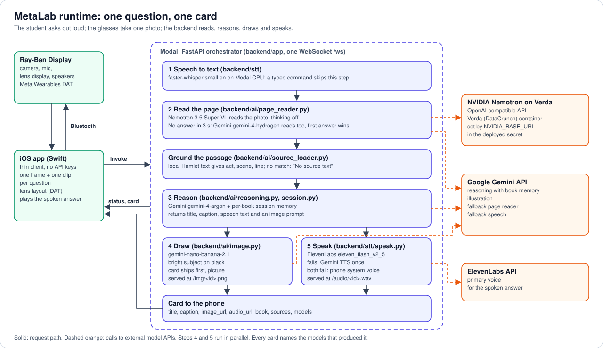
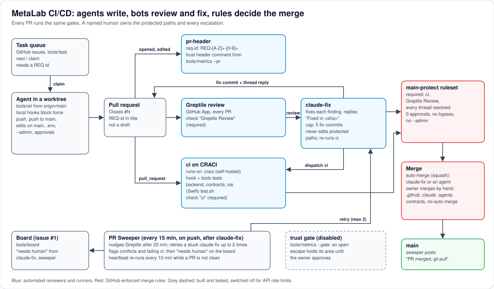

# MetaLab

A high-school student is reading *Hamlet* and hits a passage they cannot picture. They ask for help out loud. The Ray-Ban Display glasses take one photo of the page, and a few seconds later an illustration of that passage appears on the lens with a two-line explanation, which is also read aloud. The answer cites the act, scene and line, and it remembers what the student already asked about this book.

MetaLab was built at Junction 2026 by a four-person team, with AI coding agents writing, reviewing, fixing and merging most of the code under the rules in [`AGENTS.md`](AGENTS.md).

- **Live backend:** `wss://junction26-vision--metalab-web.us-east.modal.run/ws` (health check: `https://junction26-vision--metalab-web.us-east.modal.run/health`)
- **License:** MIT ([`LICENSE`](LICENSE))

## Contents

- [Who it is for](#who-it-is-for)
- [Architecture](#architecture)
- [How it works, step by step](#how-it-works-step-by-step)
- [Tracks](#tracks): [Meta](#meta-ai-glasses), [Gemini](#google-deepmind-gemini-api), [Nemotron](#nvidia-nemotron), [Verda](#verda), [ElevenLabs](#elevenlabs), [Modal](#modal), [CRACI](#craci), [Tieto](#tieto-earned-trust-in-ai-code)
- [Run and test](#run-and-test) · [Deploy](#deploy) · [Privacy](#privacy) · [Repository map](#repository-map)

## Who it is for

Students reading a set text on paper. A classic play is hard to picture: old language, many characters, staging that is never described. Looking things up on a phone breaks the reading. MetaLab keeps the student on the page:

- One invocation sends one camera frame and one spoken (or typed) command. Nothing is captured in the background.
- MetaLab reads the photographed page and places it in the public-domain text (act, scene, line). A page it cannot place says "No source text" instead of guessing.
- It answers with the memory of the book session: which book, where the student is, and what they already asked.
- It draws an illustration made for the additive lens (a bright subject on black) and shows it with a short caption.
- It speaks the answer, so the flow also works with the display off.

## Architecture



All logic stays in the backend. The phone app only captures, sends, shows and speaks, and it holds no API keys. The WebSocket messages are defined once in [`contracts/ws-messages.schema.json`](contracts/ws-messages.schema.json): the phone sends one `invoke`, and the backend answers with `status` messages (`transcribing`, `reading`, `thinking`, `drawing`) and then exactly one `card` or `error`.

## How it works, step by step

1. **Ask.** The student says "Hey Meta, start MetaLab", then a command such as "explain this". The glasses' voice invocation reaches the iOS app through the Meta Wearables Device Access Toolkit (DAT) ([`ios/MetaLab/GlassesBridge.swift`](ios/MetaLab/GlassesBridge.swift)).
2. **Capture.** The app records about 4 s of audio over the Bluetooth mic, takes one 720×1280 frame from the glasses camera and stops the camera before it uses the display ([`ios/MetaLabCore/Sources/MetaLabCore/CapturePlan.swift`](ios/MetaLabCore/Sources/MetaLabCore/CapturePlan.swift)). It sends one `invoke` over a WebSocket.
3. **Speech to text.** faster-whisper `small.en` runs on the Modal container ([`backend/stt/engine.py`](backend/stt/engine.py)). A typed command skips this step. `STT_ENGINE=gemini` switches to Gemini transcription, which falls back to Whisper on any failure.
4. **Read the page.** NVIDIA Nemotron 3.5 Super VL turns the photo into text, with thinking disabled ([`backend/ai/page_reader.py`](backend/ai/page_reader.py)). If Nemotron has not answered within 3 s (`READ_FALLBACK_AFTER_S`) or fails, Gemini `gemini-4-hydrogen` reads the same frame and the first answer wins. A page with no readable text ends the request with `no_text_found`.
5. **Ground the passage.** The page text is matched against the bundled public-domain *Hamlet* ([`backend/ai/source_loader.py`](backend/ai/source_loader.py), [`backend/ai/data/plays/`](backend/ai/data/plays/SOURCES.md)), which gives the exact act, scene and line. No match means "No source text" and no sources.
6. **Reason.** Gemini `gemini-4-argon` gets the passage and the book session (book, reading position, earlier questions and answers) and returns the title, caption, spoken text and an image prompt ([`backend/ai/reasoning.py`](backend/ai/reasoning.py), [`backend/ai/session.py`](backend/ai/session.py)). Reasoning has no second model: a failure returns a retryable `internal` error.
7. **Draw and speak, in parallel.**
   - Gemini `gemini-nano-banana-2.1` draws the illustration on a black background ([`backend/ai/image.py`](backend/ai/image.py)). The card does not wait for it: it ships with a reserved `image_url`, and `GET /img/<id>.png` holds the request open until the picture is ready (up to 25 s). If drawing fails, the card is text only.
   - ElevenLabs `eleven_flash_v2_5` speaks the answer ([`backend/stt/elevenlabs.py`](backend/stt/elevenlabs.py)). If it fails, Gemini `gemini-3.8-flash-tts` is tried once within the same 20 s budget ([`backend/stt/speak.py`](backend/stt/speak.py)). If both fail, `audio_url` is null and the phone reads `speech_text` with the system voice.
8. **Show.** The phone sends a DAT display layout (image and text) to the lens and plays the clip. Every card names the models that produced it in its `models` field.

**Time limits.** Each backend stage has 25 s and the whole request 85 s, so the phone (30 s without a message, 90 s in total) always gets a `model_timeout` error instead of hanging ([`backend/app/pipeline.py`](backend/app/pipeline.py)). Every constant and override is listed in [`docs/CONSTANTS.md`](docs/CONSTANTS.md).

## Tracks

### Meta: AI glasses

- **How we use it.** The Ray-Ban Display glasses are the whole interface: voice invocation, the camera frame, the Bluetooth mic, the lens display and the speakers, all through the Meta Wearables DAT SDK (`meta-wearables-dat-ios` 1.0.1).
- **Why it is essential.** The point of MetaLab is help that does not take the student's eyes off the page. Only glasses can see the page the student sees and show the answer in their line of sight.
- **Files.** [`ios/MetaLab/GlassesBridge.swift`](ios/MetaLab/GlassesBridge.swift), [`ios/MetaLab/AppModel.swift`](ios/MetaLab/AppModel.swift), [`ios/MetaLabCore/`](ios/MetaLabCore), [`ios/README.md`](ios/README.md).
- **Evidence.** [`docs/evidence/HOST.md`](docs/evidence/HOST.md) (Meta row), [`ios/HARDWARE.md`](ios/HARDWARE.md); the capture order and contract are tested in `ios/MetaLabCore/Tests/` and `ios/tests/test_client.py`.

### Google DeepMind: Gemini API

- **How we use it.** Gemini does the thinking and the drawing: `gemini-4-argon` reasons over the passage with the book session's memory, `gemini-nano-banana-2.1` draws the illustration, `gemini-4-hydrogen` is the fallback page reader, and `gemini-3.8-flash-tts` is the fallback voice. Optional modes add Gemini transcription and Gemini decision routing (`DYNAMIC_MODEL_ROUTING`).
- **Why it is essential.** The explanation and the picture are the product. Gemini turns a grounded passage plus the student's history into a two-line answer, and turns that answer into an image tuned for a see-through display.
- **Files.** [`backend/ai/reasoning.py`](backend/ai/reasoning.py), [`backend/ai/image.py`](backend/ai/image.py), [`backend/ai/session.py`](backend/ai/session.py), [`backend/ai/decision.py`](backend/ai/decision.py), [`backend/stt/speak.py`](backend/stt/speak.py).
- **Evidence.** [`docs/evidence/HOST.md`](docs/evidence/HOST.md) (Gemini row and model ledger), [`docs/evidence/base-live.md`](docs/evidence/base-live.md) (live runs with exact Hamlet citations).

### NVIDIA: Nemotron

- **How we use it.** Nemotron 3.5 Super VL is the first model in every request. It reads the photographed page through an OpenAI-compatible API, with `chat_template_kwargs.enable_thinking=false` for speed.
- **Why it is essential.** Everything after it depends on the page text: the passage match, the citation and the explanation. A wrong read means a wrong answer, so reading is its own step with its own model and a hedged fallback.
- **Files.** [`backend/ai/page_reader.py`](backend/ai/page_reader.py), [`backend/ai/measure_accuracy.py`](backend/ai/measure_accuracy.py).
- **Evidence.** [`docs/evidence/HOST.md`](docs/evidence/HOST.md) (live cards reported read model `nemotron-3.5-super-vl`).

### Verda

- **How we use it.** The Nemotron page reader is served from a Verda (formerly DataCrunch) container endpoint. The deployed Modal secret sets `NVIDIA_BASE_URL` to that endpoint; the code default stays NVIDIA's hosted API, so nothing in the code is tied to one host.
- **Why it is essential.** Page reading is on the critical path of every request. A dedicated container gives us our own Nemotron capacity instead of a shared hosted queue.
- **Files.** [`backend/ai/page_reader.py`](backend/ai/page_reader.py) (`NVIDIA_BASE_URL`), [`backend/app/config.py`](backend/app/config.py).
- **Evidence.** [`docs/evidence/HOST.md`](docs/evidence/HOST.md) (Verda row and endpoint ledger).

### ElevenLabs

- **How we use it.** ElevenLabs `eleven_flash_v2_5` speaks every answer as 24 kHz audio. The clip is served at `audio_url` and played through the glasses' speakers.
- **Why it is essential.** The display is small and sometimes off. Speech is what makes MetaLab usable without looking away from the page, and a natural voice matters for a student listening to literature.
- **Files.** [`backend/stt/elevenlabs.py`](backend/stt/elevenlabs.py), [`backend/stt/speak.py`](backend/stt/speak.py), [`backend/scripts/voice_check.py`](backend/scripts/voice_check.py).
- **Evidence.** [`docs/evidence/HOST.md`](docs/evidence/HOST.md) (ElevenLabs row: live on deploy v10), [`docs/evidence/base-live.md`](docs/evidence/base-live.md).

### Modal

- **How we use it.** Modal hosts the FastAPI app and its public WebSocket, runs Whisper on CPU with the weights baked into the image, holds the secrets, and provides the volume for the opt-in transcript log.
- **Why it is essential.** The phone is a thin client, so the backend is the product's brain. Modal gives it a public `wss://` endpoint, secrets kept off the phone, and a one-command deploy.
- **Files.** [`backend/app/modal_app.py`](backend/app/modal_app.py), [`backend/app/main.py`](backend/app/main.py), [`backend/app/config.py`](backend/app/config.py).
- **Evidence.** [`docs/evidence/HOST.md`](docs/evidence/HOST.md) (Modal row), [`backend/README.md`](backend/README.md) (deploy steps).

### CRACI

- **How we use it.** The required `ci` check runs on CRACI's self-hosted runners (`runs-on: craci`). It installs Swift 6.0 and runs the hook and tools tests, `backend/test.sh`, `contracts/test.sh` and `ios/test.sh` (including the `MetaLabCore` Swift tests) on every pull request and every push to `main`.
- **Why it is essential.** `ci` is one of the two checks GitHub requires before any merge. With agents opening dozens of PRs, every merge decision rests on this job.
- **Files.** [`.github/workflows/ci.yml`](.github/workflows/ci.yml).
- **Evidence.** [`docs/evidence/BUILD.md`](docs/evidence/BUILD.md) (section 5: first CRACI runs, the Swift coverage gap and how it was closed).

### Tieto: Earned trust in AI code

AI agents wrote most of MetaLab. Our answer to "when can you trust AI code?" is **bounded autonomy, tiered by risk**: bots write, review and fix; GitHub-enforced rules decide what merges; a named human owns the paths that define the rules and every escalation. The full argument is the [concept card](docs/TIETO_CONCEPT_CARD.md).



**The pipeline, in the order a change goes through it:**

1. **Task and requirement.** Work starts from a GitHub issue. `tools/task next` serves the next ready task and `tools/task claim` takes it. Every task and PR names a requirement id from [`docs/REQUIREMENTS.md`](docs/REQUIREMENTS.md), so an owner can accept a change against one stated requirement and its acceptance command.
2. **One worktree per task.** `tools/wt <issue>-<slug>` branches from fresh `origin/main` into its own folder. Local hooks ([`.claude/hooks/`](.claude/hooks), [`.agents/hooks/`](.agents/hooks)) block force pushes, pushes to `main`, edits on `main`, reading `.env`, `--admin` merges and review approvals before the command runs.
3. **The board.** Agents coordinate on a pinned issue through `tools/board`. Conflicts between agents are settled there by a fixed precedence order (`AGENTS.md` §6), and every escalation names a person.
4. **req-id check.** The `pr-header` workflow fails a PR whose title and body carry no `REQ-…` id, and posts a trust header on each PR (rendered by `tools/metrics --pr`): requirement text, risk tier, owners, check states, thread dispositions and fix-loop usage.
5. **Greptile review.** The Greptile GitHub App reviews every non-draft PR. Its `Greptile Review` check is required.
6. **claude-fix.** When Greptile comments, [`claude-fix.yml`](.github/workflows/claude-fix.yml) runs Claude on the PR. It treats PR text as untrusted data, fixes each finding in one commit, replies `Fixed in <sha>` or `needs human: <reason>`, and re-runs `ci`. It stops after 5 fix commits, never edits `.github/`, `.claude/`, `.agents/` or `contracts/`, and fails loudly when a secret is missing.
7. **ci on CRACI.** The required `ci` job (see [CRACI](#craci)).
8. **Merge authority.** The `main-protect` ruleset requires `ci`, `Greptile Review` and every review thread resolved, with no bypass actors. `claude-fix` or an agent may then enable squash auto-merge. A PR that touches a protected path, or carries the `no-auto-merge` label, is merged by its owner by hand (`AGENTS.md` §3 rule 9). No bot ever approves a review.
9. **Sweeper and metrics.** [`pr-sweeper.yml`](.github/workflows/pr-sweeper.yml) runs every 15 minutes: it nudges Greptile if a review is missing, retries a stuck `claude-fix` at most twice, and posts conflicts, failing `ci` and "needs human" to the board. [`tools/metrics`](tools/metrics) recomputes trust from GitHub data: time to merge, disposition coverage, AI finding acceptance, share routed to humans and escape rate.
10. **Trust gate.** `tools/metrics --gate` withdraws trust from an area while a defect that escaped review (an issue labelled `escape`) is open, until the owner approves. It was validated with a live drill ([`docs/evidence/TRUST-PIPELINE.md`](docs/evidence/TRUST-PIPELINE.md)); the `trust` workflow is switched off because of GitHub API rate limits, and the gate stays covered by `ci` self-tests.

**Measured** (from `tools/metrics`, PRs #67 onwards, measured 2026-11-14 22:54 UTC; [concept card §5](docs/TIETO_CONCEPT_CARD.md)): 78 PRs opened and 77 merged, with a median time to merge of 8.7 minutes; 180 Greptile threads, 135 fixed, 44 resolved without a written reply (most before the reply rule existed); 54 `claude-fix` commits; 0 reverts; 7 merged PRs later named by an escape issue. One real PR is walked through end to end in [`docs/evidence/TRUST.md`](docs/evidence/TRUST.md) §2.

**Lessons learned** (the full list, with times and fixes, is the [lessons log](docs/TIETO_LESSONS_LOG.md)):

- **A rule written in prose is not enforced.** A PR whose author wrote "no auto-merge" merged itself. We added the `no-auto-merge` label that `claude-fix` reads, and wrote the merge rule once.
- **Silence is not acceptance.** 59% of early AI findings were resolved without a word. We now require `Fixed in <sha>` or `Not changing: <reason>` on every thread and measure coverage.
- **A control that is not monitored is not a control.** The sweeper's retry step failed on 170 of 200 runs before anyone noticed.
- **Match the workflow to the merge strategy.** Branches stacked on unmerged work broke after squash merges, so `tools/wt` always branches from fresh `origin/main`.
- **State what was not checked.** The iOS app target is not compiled in CI, live model calls never run in CI, and a stubbed speech client hid a wrong API shape until a live run. Each PR header lists these gaps.

## Run and test

```sh
backend/test.sh      # backend unit tests, offline stubs for every model (builds backend/.venv)
contracts/test.sh    # schema, fixtures, and recorded exchanges replayed against the backend
ios/test.sh          # iOS client proxy tests, plus the MetaLabCore Swift tests when Swift is installed
```

Run the backend locally after `backend/test.sh` has built its virtualenv:

```sh
cd backend && .venv/bin/uvicorn app.main:app --reload
```

Without keys the stages run as offline stubs. `WS_URL=wss://…/ws contracts/test.sh` replays the exchanges against a deployed backend ([`contracts/README.md`](contracts/README.md)). The iOS app is built in Xcode from `ios/MetaLab.xcodeproj` ([`ios/README.md`](ios/README.md)).

## Deploy

```sh
modal secret create metalab NVIDIA_API_KEY=... NVIDIA_BASE_URL=... GEMINI_API_KEY=... IMAGE_BASE_URL=https://<workspace>--metalab-web.modal.run
modal deploy backend/app/modal_app.py
```

The ElevenLabs key and voice come from the separate Modal secrets `ELEVEN_LABS_KEY` and `ELEVVOICE_ID`. The full steps, the warm-container option and the voice check are in [`backend/README.md`](backend/README.md); every variable is listed in [`backend/.env.example`](backend/.env.example) and [`docs/CONSTANTS.md`](docs/CONSTANTS.md).

## Privacy

- One frame and one audio clip per invocation, only after the user asks.
- The backend processes the frame and audio in memory and drops them once the card is built, without writing them to disk. Logs carry exception types, never user text. On the phone, a developer toggle ("Keep a sample frame for the reading test") saves captured photos in the app's Documents folder; it is off by default.
- Generated images and spoken clips stay in backend memory so the lens and phone can load them. A book session idle longer than `SESSION_IDLE_TTL_S` (one hour by default) is deleted with its history, clips and images, and their URLs then return 404. Cleanup runs when the next request starts, not at the timeout itself. A session with a request in flight is never expired.
- The book session holds text only: book, position, earlier questions and answers.
- If a frame has no readable text, MetaLab says so and discards it.
- WebSocket bearer-token auth is available (`WS_AUTH=on`, `WS_AUTH_TOKEN`) and off by default.
- The opt-in STT debug log (`STT_DEBUG_LOG=on`) is the one exception: it stores transcripts on a Modal volume for test runs only ([`backend/README.md`](backend/README.md)).

## Repository map

- `ios/`: the Swift phone app (capture, WebSocket client, lens layout, speech) and the `MetaLabCore` package.
- `backend/app/`: FastAPI orchestrator, config, pipeline, error mapping, latency logging, Modal app.
- `backend/stt/`: speech to text, command matching, spoken answer.
- `backend/ai/`: page reading, Hamlet source text, book session, reasoning, image generation.
- `contracts/`: the WebSocket schema, fixtures, recorded exchanges and the conformance harness.
- `tools/`: team scripts (`board`, `task`, `wt`, `metrics`, `kickoff`) and their tests.
- `docs/`: requirements registry, constants, Tieto concept card and lessons log, and the evidence files in `docs/evidence/`.
- `.github/`: workflows (`ci`, `pr-header`, `claude-fix`, `pr-sweeper`, `trust`), CODEOWNERS, issue and PR templates.
- `.claude/`, `.agents/`: agent permissions and safety hooks.
