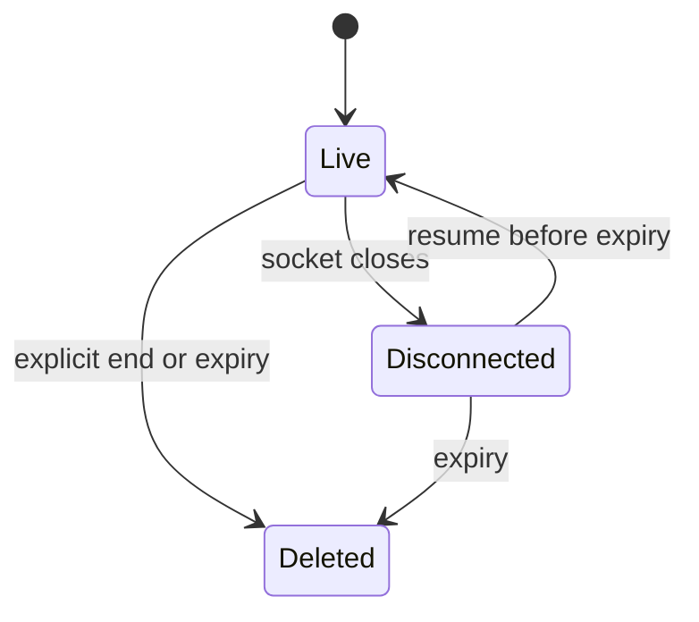

# Proposed `metalab.v2` lifecycle

Issue [#128](https://github.com/moterodiaz/Junction/issues/128), REQ-WS-04 and
REQ-PRIV-03; PRD §§6–7, §12.2. **Contract proposal, not a shipped capability.**
Ahmed owns backend implementation; Maksym owns iOS implementation and verification.
Compatibility review is requested on the
[board proposal](https://github.com/moterodiaz/Junction/issues/1#issuecomment-6880594172).
Do not infer owner agreement from passing tests or silence.

## Negotiation and compatibility

The `/ws` endpoint and `ws-messages.schema.json` remain unchanged. A new client
may offer `Sec-WebSocket-Protocol: metalab.v2` at the WebSocket handshake. It must
observe a successful HTTP upgrade selecting **exactly `metalab.v2`** before
sending lifecycle controls or accepting lifecycle responses. Offering it is not
negotiation. Failure, an absent selection, or an unsupported selection never
authorizes new controls. With no selection, fall back to legacy messages only
(or stop locally if the requested action requires v2). Never fake a successful
end/reset acknowledgement on a legacy connection.

The new server selects v2 only when offered and supported. A legacy connection
receives only legacy `status`/`card`/`error`, never unsolicited lifecycle events.
An unexpected lifecycle control on legacy is rejected using the established
legacy invalid-request error, not a v2 error. Auth off leaves old clients usable.
Do not advertise v2 until the runtime can honor **all** these semantics.

On v2, existing `invoke`, `status`, `card` and `error` still use the old schema.
Only lifecycle messages use `ws-lifecycle.schema.json`; do not widen the old
schema or the old Swift enum. Message direction and state/order are additional
constraints, not properties that JSON Schema can prove.

## Wire messages

| Direction | Type | Fields besides `type` | Meaning |
|---|---|---|---|
| Client → server | `cancel` | `request_id`, `session_id` | Target this invocation, not the entire socket/session. |
| Server → client | `cancelled` | `request_id`, `session_id` | The targeted invocation's terminal result. No new legacy error code. |
| Client → server | `session_end` | `request_id`, `session_id` | End control ID, distinct from every invocation/control ID on the connection. |
| Server → client | `session_ended` | `request_id`, `session_id`, `cleanup: "complete"` | Echo the end control ID only after application cleanup completes. |
| Server → client | `lifecycle_error` | `request_id`, `session_id`, `code` | Reject a control or an unaccepted v2 invoke. Not an accepted invocation's terminal result. |

IDs are opaque, nonblank, non-secret strings. Generate fresh unpredictable session
IDs; a session ID is not authentication. Bind sessions and controls to the same
connection ownership/security context; another connection cannot cancel, resume,
read or end someone else's session. Resume transfers ownership only after the
previous connection has disconnected and the same client/security context is
verified. Do not expose another session's existence through detailed errors.
Reject an ownership mismatch with `session_unavailable`. Auth-off deployments
must still provide isolation; knowledge of someone else's session ID alone is
not authorization. The owner implementation must specify how it verifies resume
ownership before offering v2; this contract does not invent a credential in JSON.

`cancel.request_id` is the existing invocation ID, not a second control ID.
For a known terminal invocation, repeated/late cancels are silent no-ops.
For an unknown invocation use `unknown_request`; for an invocation known to
belong to another session owned by this connection use `session_mismatch`.
An unavailable/deleted/unauthorized session uses `session_unavailable`.
Reusing an invocation or end-control ID for a different operation uses
`duplicate_request`. Rejected invokes do not start work or extend expiry.
Invalid shapes/directions use the existing fixed legacy invalid-request error;
they must not cause lifecycle side effects.

## Invocation cancellation and terminal ordering

An invocation is accepted only after validation, ownership/session checks, the
expiry check and unique-ID admission. Accepted queued work counts as pending.
Keep processing inbound controls while provider work is running or queued.

Serialize completion, cancellation, disconnect, end and expiry against a
per-invocation terminal decision. Completion may win with one existing `card` or
`error`; cancellation may win with one `cancelled`. A connected accepted invocation
gets **exactly one** terminal result. No status or second terminal follows it.
The winner's decision, history commit (successful card only) and terminal enqueue
must be atomic relative to cancellation. A failed/cancelled invocation never
appends its question, partial answer, position or other uncommitted history.
Cancel/discard late provider results and uncommitted generated media too.
Do not delete previously completed context when cancelling one request.

Disconnect cancels all pending work owned by that socket, including queued work,
without committing it. A closed transport cannot deliver a terminal response:
do not invent a received `cancelled`, replay it after reconnect, or require a
terminal delivery for abandoned work. A completion that already won before
disconnect may remain committed; an unsent frame is not evidence of delivery.
These rules do not promise network-level exactly-once receipt across a socket
failure. Invocation IDs are not retried on a resumed connection.

## End, reset and resume

End marks the named session Deleted and makes all its state/media inaccessible
immediately. Cancel all its pending invocations, without affecting other sessions.
While the socket remains connected, send their `cancelled` terminals before the
`session_ended` acknowledgement. Delete session text (including book context),
caches and generated images/audio, including partial results and owned delivery
copies. Only then send `cleanup: "complete"`. Never acknowledge scheduled cleanup
as complete. No acknowledgement can be delivered after disconnect; cleanup must
continue without the socket. A failed cleanup must not send a success ack.

Repeating the identical end control is idempotent: return the same cleanup ack
after cleanup, without recreating state or duplicating invocation terminals.
An end on an already deleted/expired or empty session owned by this client can
acknowledge completed cleanup; it cannot restore content. Reset is end followed
by a **fresh session ID**, not reuse of a Deleted ID. Old responses are stale and
the phone must discard them after reset. Session IDs never resurrect deleted
context; backend restarts must not restore user content from persistent storage.

V2 disconnect retains completed book context until end/expiry. The same client
may resume it before expiry on a newly negotiated v2 connection. This is an
opt-in addition, not a change to the existing legacy phone's new-ID reconnect.

## Expiry and application retention

Use a server **monotonic** clock, not wall time or client timestamps. The deadline
is the last **accepted invocation** time plus **900 seconds (15 minutes)**.
Creation anchors an empty session. At `now >= deadline`, atomically mark Deleted,
deny access/resume/admission and revoke all text/cache/media delivery immediately.
Check before admitting an invocation at the boundary; it cannot refresh an
already expired session. Enforce this even if a cleanup worker has not run yet.

An accepted invocation just before the boundary refreshes it. Rejected/duplicate
invokes, provider progress/completion, pings, media reads, cancel, disconnect and
reconnect do not. Expiry cancels pending work exactly like end, emitting
`cancelled` only on a still-connected v2 socket. No unsolicited expiry message is
required. Later access uses `session_unavailable`, not a revived empty session.
Application cleanup must finish by **deadline + 5 seconds**, inclusive, with no
accessible grace period. Existing per-request/phone timeouts remain unchanged.

Every access path, including previously issued image/audio URLs and caches, must
enforce revocation. Revoke access to in-flight/late results and prevent them from
repopulating Deleted state. Phone presentation/download caches are session-only:
clear on end/known expiry; discard stale responses after disconnect/reset. A
disconnected phone must not keep content past its conservative local retention
deadline; a local timer is not proof of server expiry or application cleanup.
Do not persist raw frames/audio, user text or secrets in fixtures/logs/evidence.

Application cleanup is not proof of provider deletion. Document provider
retention, originals/derivatives, CDN invalidation and backup limitations
separately. A public URL that remains readable past revocation, or a provider
policy incompatible with session-only retention, blocks activation rather than
weakening this contract.

## Optional auth handoff, default off

Auth is independent of v2 negotiation. It is **disabled by default**; no flag or
server/client config is changed here. Auth-off requires no credentials, even for
legacy clients. It is not proof of an authenticated session or safe public access.

Only enable after Maksym verifies the real iOS WebSocket API can set the
`Authorization: Bearer <credential>` **handshake header over WSS**, Ahmed verifies
handshake validation, and the owners explicitly agree rollout. While enabled,
missing, malformed, expired or invalid credentials fail closed **before upgrade**
for legacy and v2 alike, with a generic HTTP 401 and no application frames.
Verifier failure/missing server configuration also fails closed (no upgrade);
never silently fall back to auth-off. Reject an insecure auth-enabled `ws://`
handshake. A valid credential still needs successful v2 selection for controls.

Never send credentials in JSON, WebSocket subprotocol values, URL paths/queries,
or logs, including proxy/access/error logs and debugging transcripts. Redact
Authorization at all layers; errors must not echo it. Fixtures use only abstract
credential states, never sample bearer values. No new credential storage,
provisioning, installation, deployment or spending is authorized by this work.

## Evidence and owner handoff

`test_lifecycle.py`, `fixtures/lifecycle/`, `lifecycle-traces.json` and
`auth-scenarios.json` are **proposed protocol tests**, not backend/iOS tests.
They check schema separation, direction/negotiation, independent expected traces,
cancellation races, end/isolation, synthetic monotonic boundaries and auth rollout.
They do not run real timers, providers, media deletion, auth or a v2 endpoint.

`test_legacy_lifecycle.py` separately exercises the **actual current** backend
over `/ws`: it rejects the new controls with old errors and does not select v2.
The existing conformance/remote tests remain legacy tests. Remote mode and
hardware checks remain opt-in and are not acceptance evidence for this proposal.

Before finalization, link explicit Ahmed/Maksym compatibility replies and the
tested revision on the PR. Before activation, A must prove runtime cancellation,
atomic history/terminal handling, isolation/resume ownership, end/expiry cleanup
and media non-retrievability; B must prove negotiation, stale-result handling,
reset/presentation cleanup and real header support. Leave v2/auth flags off and
[#128](https://github.com/moterodiaz/Junction/issues/128) open until tests and
compatibility agreement are complete. No product release gate is accepted here.
